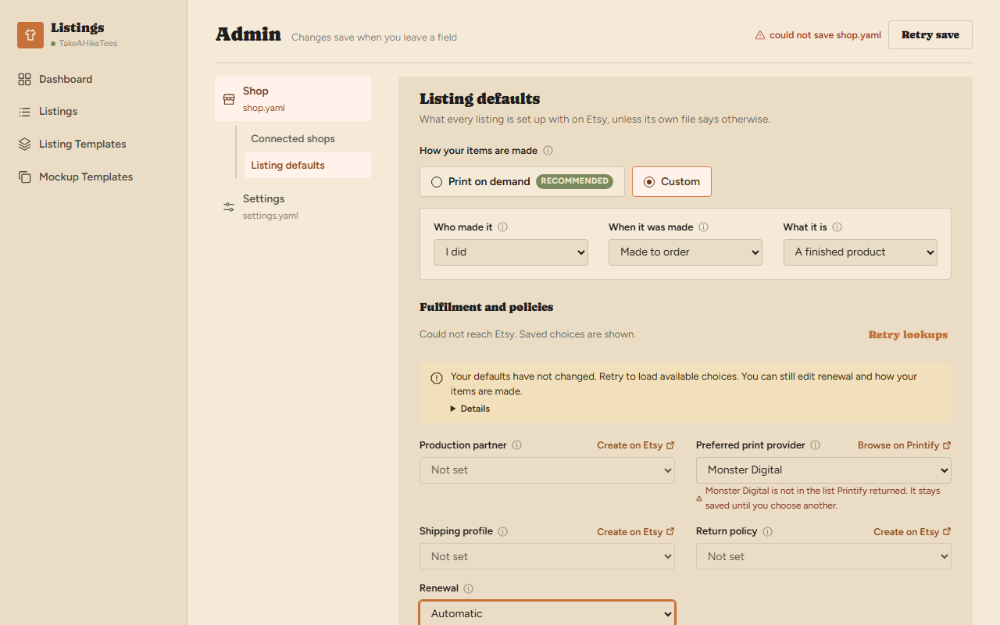

# Admin audit fixes: Shop state and OAuth

The 2026-10-31 audit of the Admin stack found four defects in Shop state and
Etsy sign-in. This page records how each was fixed, what proves it, and the
UI decisions the fixes required. The requirements are unchanged: the
[plan](plan.md) and [interactions](interactions.md) remain the authority, and
the mechanism is described in [architecture](../../architecture.md#shop-administration).

## R1: saved Shop defaults published out of order

A Shop save replaced `shop.yaml` under the revision lock but assigned
`workspace.defaults` after the lock was released. A second save made against
the first one's revision could write and publish GBP before the first
published EUR, leaving the file on GBP and every later run on EUR.

`replace_if_unchanged` now takes an `adopt` callback, run inside the same lock
once the file holds the result. `edit_shop` publishes there. Publication
follows file order, a refused change or failed write publishes nothing, and
no lock leaves `revisions.py`. Conflict and no-op semantics are unchanged; a
run in progress keeps the `Workspace.snapshot()` it took.

| Regression | Proves |
|---|---|
| `test_successive_saves_publish_defaults_in_the_order_they_were_written` | Save A holds at its publication; save B, made against A's revision, cannot overtake it. File, read, live workspace and next snapshot all say GBP; an earlier snapshot still says NOK. Failed before the fix with `EUR != GBP`. |
| `test_a_save_that_cannot_be_written_adopts_nothing` | An `os.replace` failure leaves the file, revision and live defaults unchanged. |

## I1: concurrent Admin reads rotated one Etsy grant twice

The Admin page requests connections and lookups at once. Each route built its
own `TokenStore`, whose lock was per instance, so with an expired access token
both refreshed the same grant. The loser's `invalid_grant` re-read the file
before the winner saved, and the page reported a withdrawn consent.

The rotation lock now belongs to the resolved token file: every store for one
file in the process shares it, and stores for other workspaces never wait.
A wait longer than `ROTATION_WAIT_SECONDS` raises `EtsyRefreshBusy`, a
retryable refusal that names no token, so a wedged refresh cannot hang every
Etsy request. Credentials still resolve lazily, and a revoked grant still asks
for `auth`.

This fixes the in-process race only. Across processes, a refresh between this
process's refresh and its save still races it; the existing `invalid_grant`
re-read is the only defence there, and no in-process lock can close it.

| Regression | Proves |
|---|---|
| `test_two_stores_for_one_file_rotate_its_grant_once` | Two independent stores, first rotation held: one rotation, no refused refresh, both get the new token. Failed before the fix with the false consent error. |
| `test_a_revoked_grant_still_asks_every_store_to_sign_in` | Real revocation is still reported. |
| `test_a_rotation_for_another_token_file_does_not_wait` | No serialization across workspaces. |
| `test_a_rotation_held_past_the_wait_is_a_retryable_refusal` | Bounded wait; the message names no token and asks for no sign-in. |
| `test_simultaneous_admin_reads_share_one_rotation_of_an_expired_sign_in` | `/connections` and `/lookups` at once, through the production client wiring with Etsy scripted at the httpx boundary: both answer, one rotation. Failed before the fix. |
| `test_a_revoked_sign_in_is_still_reported_to_both_admin_reads` | Both rows report the withdrawn consent. |

## Q1 and Q2: Shop autosave acknowledgement and retry

Q1: Shop's `BlurSelect` dropped its draft whenever the saved value changed,
so the answer to an older save replaced a newer choice, focused or queued.
Q2: Shop marked a field committed before the request succeeded and reported
Saved after any later success, so a failed field looked saved and a blur
could not resend it.

Settings already retained failed patches. The two hooks now share one owner,
`useSaveQueue`, for what both files must agree on:

- saves run one at a time, each naming the revision the previous one returned;
- every change key is tracked until a save of that key succeeds, and a newer
  save of the key supersedes its failure;
- an unrelated success never reports Saved while a key is failed; the status
  keeps that failure's message;
- Retry save sends exactly the failed keys;
- each key's newest unanswered value, whether a field save or Retry sent it,
  is `pending` until its answer arrives, and the answer's values are adopted
  in the same update that clears it;
- a conflict stops the queue until the seller reloads.

Each panel keeps its own editing rules. Settings' controls still keep newer
local values and reset only on `loadedVersion`; coupled provider and run-limit
saves and rapid serialization are unchanged.

`BlurSelect` identifies each save by the edit it was made from. Only that
save's answer drops the draft, and only if nothing was chosen since. Listing
defaults show the saved Shop with the queue's pending values over it: what the
file will hold once sent saves land. A blur sends the draft when it differs
from that, so choosing back the old value while any save of the field is in
flight, a Retry included, still sends it, and choosing the value already on
its way sends nothing more. A failed save keeps the draft and the next blur resends it; a
refused value stays shown with its error and is not resent until changed.
Reloading remounts the listing defaults for the new file.

A successful Retry save adopts the returned Shop values as well as the
revision. Otherwise a later choice back to the original value could be
mistaken for a no-op. Repeated retry failures stay in the queue's error
status without an unhandled promise rejection from the button. An independent
review then found the same gap while Retry was still pending: the select did
not know Retry was carrying auto, compared manual with the saved manual and
sent nothing, leaving auto on disk under Saved. Field saves and Retry now share
the queue's per-key pending identity above, rather than each control
remembering only its own saves.

A specification review found two more interactions:

- **A cancelled currency change was retried.** A failed Change in the currency
  dialog left `currency: EUR` among the queue's failed keys. After Keep, close,
  Escape or the backdrop, a sibling success still could not show Saved, and the
  page's Retry save would send EUR without the dialog's acknowledgement. The
  dialog shows its own failure and retries only through its acknowledged
  Change, so it now saves with `retain: false`: that failure is not kept for
  Retry, adds no page field error, and leaves the page status to the retained
  failures. Sibling failures and their errors are untouched, and revision
  checks are unchanged. This concerns a failed request; cancelling never undoes
  a write the server already made.
- **Use it bypassed the field's draft.** Use it saved directly, so a draft
  chosen back to the saved value, or a failed draft, stayed shown over what Use
  it wrote, and leaving the select then wrote the old draft back. Each list
  field now has one draft owner (`useDraft`) that both the select and Use it go
  through: Use it is a choice that replaces an older draft and is sent at once,
  and a choice made while its request is pending survives the answer and is
  saved after it.

| Regression | Proves |
|---|---|
| `keeps a newer focused choice when an older save is answered` | Deferred response: the focused newer choice stays, keeps focus, and its blur saves it. |
| `keeps a newer queued choice while the older save is answered` | The queued newer choice is never replaced and ends on disk. |
| `keeps a failed field unsaved through a sibling's success until it is retried` | Renewal fails, Who made it succeeds: no Saved, the error stays, the server keeps manual; Retry save sends `{renewal: auto}` only. |
| `adopts a retried save before changing back to the original value` | After Retry writes auto, choosing manual sends a new request and persists it. Failed before the follow-up correction with only two requests. |
| `saves a choice made while a retry is pending, after the retry lands` | Retry of auto held; choosing manual meanwhile queues `{renewal: manual}` against the retry's revision; disk and control end on manual under Saved. Failed before with two requests. |
| `sends nothing more for a choice that matches the pending retry` | Choosing auto while Retry carries auto sends no duplicate write. Failed before with a third request. |
| `keeps a failed retry visible and lets another retry succeed` | A failed retry retains the error and failed value, then the next retry succeeds. |
| `retries a failed unchanged value when its field is left again` | Blurring the unchanged failed value resends it. |
| `keeps a failed save failed through an unrelated success and retries only that patch` (Settings) | The shared contract on Settings: provider failure survives a concurrency success; Retry sends only `providers` against the newer revision. |
| `never retries a currency change cancelled with Keep/close/Escape/backdrop after it failed` | After a failed EUR Change and each cancel, a Renewal success shows Saved with no Retry, and currency was sent once. Failed before: no Saved. |
| `retries a sibling's failure but not a cancelled currency change` | A failed Renewal keeps its error through a failed, cancelled currency change; Retry sends only `{renewal: auto}`. Failed before: the status showed the currency failure. |
| `reports Saved when a newer save supersedes a failed one` | Control: an older failed Renewal save superseded by a newer successful one leaves Saved and no Retry. |
| `shows what Use it wrote over a draft chosen back to the saved value` | EU then US with no write; Use it writes UK; the select shows UK and leaving it writes nothing. Failed before: the select still showed US. |
| `shows what Use it wrote over a failed draft` | A failed EU draft; Use it writes UK; the select shows UK, no Retry, and leaving writes nothing. Failed before: the select still showed EU. |
| `keeps a choice made while Use it is pending and saves it after` | Control: with Use it held, choosing EU survives its answer and is saved against its revision. |
| `test_admin_shop_browser.py` | Built SPA, real API, fixture `shop.yaml`, both color preferences: the queued choice ends on disk; the failed field survives a sibling write and Retry save writes it; a choice made while Retry is held reaches the file after it (timed out waiting for that request against the previous build); Use it over a failed draft leaves `shop.yaml` and the select on UK with no further write (the select kept EU against the previous build). |

### UI decision

Shop gains the Retry save button Settings already had, beside the save status
in the page heading. It appears only for an error, never for a conflict,
which keeps Reload shop.yaml. Focus stays on the field that failed; the
status is announced through the existing `role="status"`. No layout or copy
changed otherwise. Checked at 1280×800 and 1024 wide, under both color
preferences (the app has one palette), for default, saving, error, retried and conflict states.

## Exit evidence

The combined code was validated at `eda9772a`, the ordinary merge of State's
`82f0aef7` and Runtime's `498badde`. Later changes to this record are prose only.

| Check | Result |
|---|---|
| `./scripts/check.sh`, with required browser prerequisites | Passed. Python: 3,779 passed, seven platform skips, 55 deselected. Combined branch-enabled coverage: 95.50%; branches: 3,837 of 4,254, or 90.20%. Frontend: 1,301 passed across 97 files; 90.28% branch coverage. |
| Format, lint, strict typing and Import Linter | Passed, all 11 contracts kept. Formatting left the checkout unchanged. |
| Separate SPA build and `npm run test:design` | Passed; four design tests. The design suite also passed inside the full gate. |
| Standalone `ETSY_LISTINGS_REQUIRE_EVERY_LAYER=1 uv run pytest -m browser` | Passed: 160 cases, zero skips. |
| Generated API | No wire shape changed. The OpenAPI export regression passed and the generated client has no diff. |

The independent Standards/process recheck reported no actionable findings at
the combined tip. Its 91 focused tests and external Windows process diagnostics
closed the exited-launcher residual. State's final Spec recheck remains pending
the Opus quota reset; the seller chose to wait for Opus 5.5 medium. The failed
recheck is not counted as a passing review.

Against Runtime, `scripts/sloc.py` measures net additions of 22 backend and 132
frontend production lines, plus 471 Python test and 351 frontend test lines.
The shared queue replaces separate Shop and Settings save coordination.

Runtime PR #150 passed all four CI checks and its parent-dispatched
[GitHub e2e run](https://github.com/eli-jordan/etsy-listing-automation/actions/runs/41256022498)
on `498badde`: 47 passed, two expected connected-shop safety skips and zero new
e2e products left behind. State CI and serialized GitHub e2e remain pending.
Local e2e is waived; no real local workspace, credentials or auth configuration
were changed.
