# Admin page interactions and prototype reference

Status: design approved 2026-10-30, including the time-limit and recovery states.
This document records the behavior that a screenshot cannot explain and points
to the prototype code an implementation agent can copy where useful. The
[implementation plan](plan.md) owns the delivery sequence and settled
configuration requirements. There is deliberately no separate product spec.

The approved source is the `admin-shop` board in
[`src/ui/design/scenes/admin-shop/`](../../../src/ui/design/scenes/admin-shop/).
Run `npx marver dev` from `src/ui` and open the printed URL, then select that
board and enter play mode. The frames share one interactive page and differ
only in starting state. `admin-shop-v1` on the archive board is the previous
round, not another implementation target.

Screenshots below are checked-in PNGs captured from the approved frames on
2026-10-30, at 1280 × 800, light theme, scale 1. They remain readable without a
running Marver server. Long pages have separate frames for their lower sections.
Use the images for visual comparison and the prose for behavior. Fixture names,
model ids, connection status and counts are examples, not production defaults.

## Where the prototype implements each element

Paths in this table link to source, and names identify functions or local
helpers within those files. Keep the fixture-driven prototype when building
the real page; production components get their own data and save operations.

| Element | Prototype implementation | Useful parts to copy |
|---|---|---|
| App sidebar and Admin entry | [`admin-settings/_layout.tsx`](../../../src/ui/design/scenes/admin-settings/_layout.tsx), `AdminLayout` | Composition around the real `ShellSidebar`, Admin icon and selected style. Replace fixture/hash links with the app router. |
| Page heading and save indicator | [`admin-settings/_parts.tsx`](../../../src/ui/design/scenes/admin-settings/_parts.tsx), `PageHead`, `SaveStatus` | Heading layout, Saving/Saved presentation. Drive status from actual requests. |
| Shop/Settings navigation | [`_prototype.tsx`](../../../src/ui/design/scenes/admin-shop/_prototype.tsx), `ShopPrototype`, `Nav` | Selected state, Shop subnavigation and mounted Settings panel. |
| Connected and disconnected shop rows | [`_prototype.tsx`](../../../src/ui/design/scenes/admin-shop/_prototype.tsx), `connected()` | Read-only identities, connection instructions and currency danger zone. |
| Currency dialog | [`_prototype.tsx`](../../../src/ui/design/scenes/admin-shop/_prototype.tsx), `CurrencyModal` | Warning layout, target-currency selector, acknowledgement and confirm/cancel controls. See the explicit-price correction below. |
| POD/Custom controls and defaults | [`_prototype.tsx`](../../../src/ui/design/scenes/admin-shop/_prototype.tsx), `listingDefaults()`, `Pick`, `set` | Radio presentation, POD summary, Custom selectors and field grid. Derivation and atomic writes need production wiring. |
| Info buttons and cards | [`_prototype.tsx`](../../../src/ui/design/scenes/admin-shop/_prototype.tsx), `Info`, `toggleInfo`, `onRootClick`; [`_parts.tsx`](../../../src/ui/design/scenes/admin-shop/_parts.tsx), `InfoButton`, `InfoCard` | One-open-card behavior, placement, dismiss behavior and field-specific copy from `_fixtures.ts`. |
| External Create/Browse and returning with an option | [`_prototype.tsx`](../../../src/ui/design/scenes/admin-shop/_prototype.tsx), `Label`, `AwayBanner`, `comeBack`, `Fresh` | Link placement and the new-option callout. Replace `AwayBanner` and injected options with a real external tab and focus refresh. |
| Shop lookup refresh and retry | [`_prototype.tsx`](../../../src/ui/design/scenes/admin-shop/_prototype.tsx), `listingDefaults()`, `offline`, `lookupPending` | Loading/failed presentation, retained saved choices and disabled unavailable selectors. |
| Provider number/dash and reorder handle | [`_settings.tsx`](../../../src/ui/design/scenes/admin-shop/_settings.tsx), `Providers`, `update`, `move`, `onHandleKey` | Row layout, enabled numbering, last-provider guard, drag/drop and keyboard reorder. |
| Model, effort and model-list Refresh | [`_settings.tsx`](../../../src/ui/design/scenes/admin-shop/_settings.tsx), `Providers` | Selectors, stale saved-model option, discovery status, retry and busy state. Discovery itself is simulated. |
| Coupled step/run time sliders | [`_settings.tsx`](../../../src/ui/design/scenes/admin-shop/_settings.tsx), `SettingsPanel`, `setRows`, `TimeLimits`, `commit` | Ranges, dynamic run minimum, coupled update and automatic-increase notice. |
| Batch concurrency slider | [`_settings.tsx`](../../../src/ui/design/scenes/admin-shop/_settings.tsx), `Batch`, `commit` | Whole-number range, live value, ticks and completion/blur handling. |
| Market weight dividers and reset | [`_settings.tsx`](../../../src/ui/design/scenes/admin-shop/_settings.tsx), `Market`, `moveDivider`, `onDown`, `onMove`, `onUp`, `onKey`, `reset` | Adjacent-share transfer, stacked zero-share dividers, pointer capture, keyboard controls and legend. Review normalization before reuse. |
| Invalid file and conflicting save | [`_settings.tsx`](../../../src/ui/design/scenes/admin-shop/_settings.tsx), `SettingsPanel`, `issue` | Error placement, disabled editing, reload/check actions. Read and validate real files in production. |
| Tokens, spacing and control styles | [`_shop.css`](../../../src/ui/design/scenes/admin-shop/_shop.css), [`admin-settings/_admin.css`](../../../src/ui/design/scenes/admin-settings/_admin.css) | Existing semantic tokens and CSS classes. Keep the approved visual proportions. |

Shop fixture options, info copy and external destinations live in
[`_fixtures.ts`](../../../src/ui/design/scenes/admin-shop/_fixtures.ts).
Provider rows and metric definitions come from
[`admin-settings/_fixtures.ts`](../../../src/ui/design/scenes/admin-settings/_fixtures.ts).
Frame files such as
[`settings-limits/d-revised.tsx`](../../../src/ui/design/scenes/admin-shop/settings-limits/d-revised.tsx)
only pass `ProtoStart` to `ShopPrototype`; they are entry states, not separate pages.

## Navigation and saving

Admin replaces the sidebar's Setup placeholder and opens `/admin`. Within the
page, Shop opens Connected shops; its subnavigation opens Connected shops or
Listing defaults. Settings shows AI providers, AI time limits, Batch AI and
Market SEO scoring in that order. The section selection stays out of the URL.
Switching sections must not discard a pending field edit or reset locally
displayed values. The prototype keeps Settings mounted while Shop is visible.

There is no page-level Save button. A select or edited field saves on blur.
A provider toggle or preset selection saves when activated; a completed drag or
slider action saves its final value. Pointer release, completed keyboard input
and blur must not produce duplicate writes for the same value. Unchanged values
do not write. The Saving indicator becomes Saved only after a successful response.

Validate the full candidate document on the server. A refused edit stays visible
with its field error and the previous saved value stays on disk. Keep unrelated
fields available when the error is field-specific. Network/write failure must
remain an error rather than turning into Saved on a timer; retain the edit for
retry. The prototype's `saved()` and `useSaves()` timers demonstrate presentation
only and do not implement validation or persistence.

Each file has its own content revision. Serialize saves for that file and use
the revision returned by the previous successful save. A comment-only external
edit is still a conflict. Never retry a refused revision with the new revision
and the old patch automatically. The seller reloads and makes the change again.
This preserves hand edits under [ADR-0055](../../adr/0055-preserve-yaml-source-when-editing.md).

## Connected shops and currency

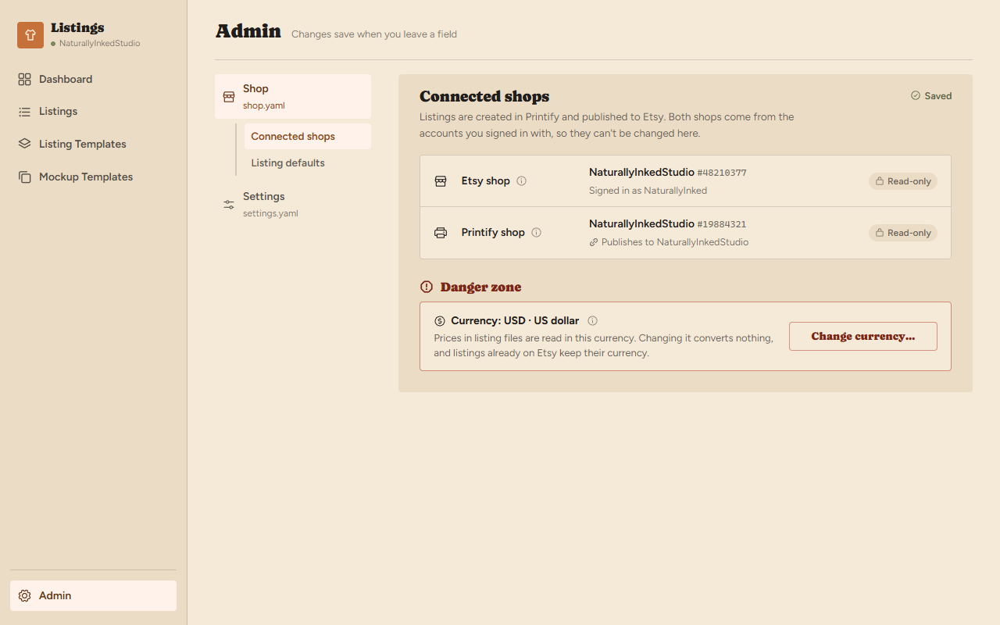

The shop names, ids, signed-in account and Printify-to-Etsy relationship explain
the configured destination. They are read-only text, not disabled shop pickers.
There are no shop-switch buttons or credential editors. Do not infer a real
Printify/Etsy relationship from the prototype's fixture shop names.

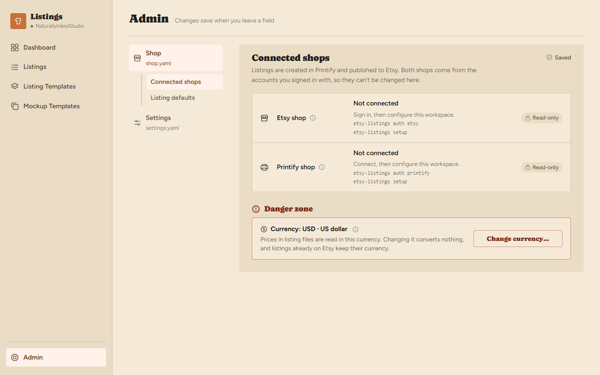

A missing shop or credential shows Not connected and the relevant authentication
or setup command. Tailor the instruction to what is missing. A service lookup
failure does not erase a configured name/id or relabel it as an absent
connection. Reloading after CLI setup reads the new configuration; clicking the
instruction does not run a shell command from the web page.

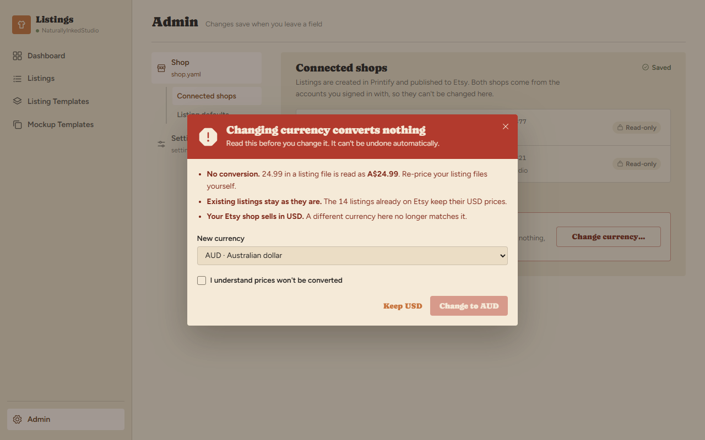

Change currency opens the warning dialog without writing anything. The selector
offers supported currencies other than the current one. Changing that selector
updates the target shown by the confirm button and any mismatch warning.
The acknowledgement starts unchecked each time the dialog opens. Until checked,
Change to [currency] is disabled. Confirmation saves only the currency and
closes after success. A failure leaves the dialog open with the error.

Keep [current currency], the close button, Escape and clicking the backdrop
cancel without saving. Clicking inside the dialog must not dismiss it. Restore
focus to Change currency on close and keep keyboard focus inside the open dialog.

The warning concerns the workspace configuration. It does not change Etsy's
shop currency, convert saved amounts, rewrite listing files or update remote
listings. Preserve explicit Money currencies under ADR-0006 and ADR-0019. The
prototype's sentence that a bare 24.99 in a file is read as the new currency is
illustrative copy that must be corrected in production: saved explicit prices
retain their currency and may need seller edits before the next deploy validates.

## Listing defaults, info cards and external lists

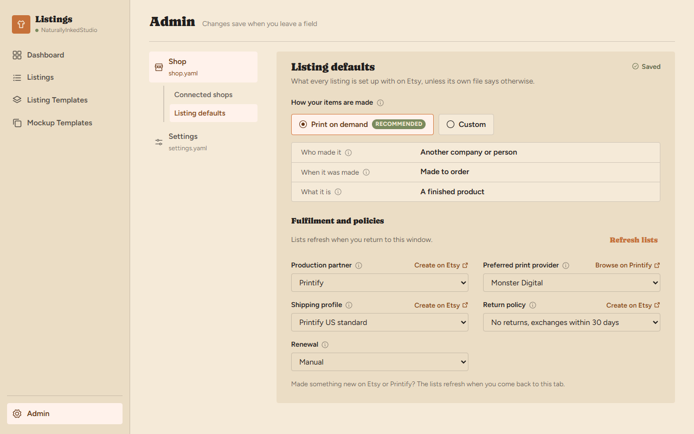

The Print on demand selection derives from the three saved values
`someone_else`, `made_to_order` and `false`. Activating it sets who made it,
when it was made and whether it is a supply in one save. Its selected state
shows the three values as a summary. It does not select or lock a production
partner. There is no advanced-settings expander or Made by me preset.

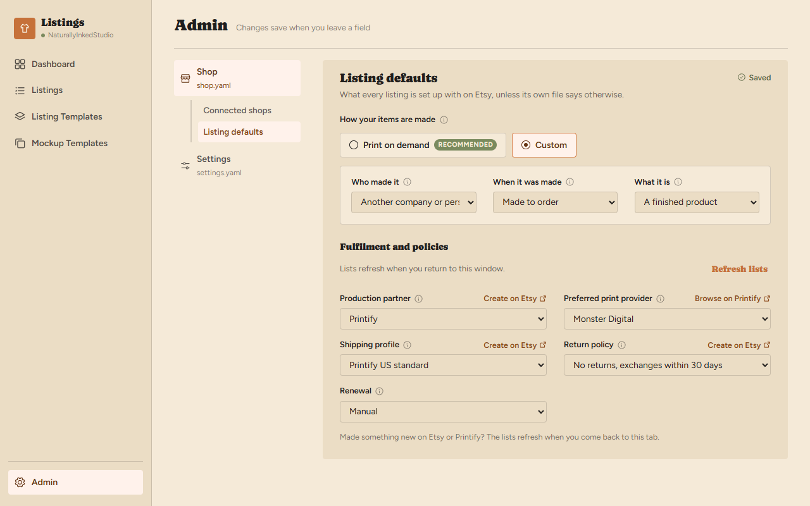

Custom exposes those selectors immediately and preserves their current values.
Choosing Custom by itself changes only the visible controls. If the values
still match POD, reopening the page selects Print on demand again. Do not add
a persisted preset key. The prototype uses a separate `tier` state and does
not set the three underlying values when switching to POD; copy its presentation,
then implement the derived state and three-value save from the plan.

Production partner, preferred print provider, shipping profile, return policy
and renewal remain independently editable. Their configuration targets are:

| Control | Saved key or identity |
|---|---|
| Currency | `shop.yaml` → `etsy.currency` |
| Who made it | `etsy.listing_defaults.who_made` |
| When it was made | `etsy.listing_defaults.when_made` |
| What it is | `etsy.listing_defaults.is_supply`, a boolean |
| Production partner | `etsy.listing_defaults.production_partner`, by name |
| Preferred print provider | `printify.preferred_print_provider`, by name |
| Shipping profile | `etsy.listing_defaults.shipping_profile`, by name |
| Return policy | `etsy.listing_defaults.return_policy`, structured acceptance/exchange/day terms |
| Renewal | `etsy.listing_defaults.renewal`, `manual` or `auto` |

These edit shop defaults. They do not copy values into existing listing files
or override a listing's explicit value. Match return policies by their terms;
their human-readable labels are not stored as policy names. Preferred print
provider offers the full Printify catalog and only preselects `new` when the
selected garment offers it.

Each info button opens the explanation for that field. Opening another closes
the first; clicking the same button, clicking outside the card, or Escape closes
it. The text explains the field, the effect of changing it and its source.
Info cards never save. Ensure both the trigger and any card actions work by
keyboard and do not rely on hover to expose required information.

Create on Etsy opens the appropriate shipping-profile, return-policy or
production-partner settings in a new tab. Browse on Printify opens its provider
catalog. The seller cannot create a Printify provider. Returning focus to Admin
refreshes the relevant lists and preserves the current selection. Newly found
options can be highlighted; only choosing the option or Use it saves it.
Returning without creating anything performs no save.

`AwayBanner` simulates the external tab. Come back with a new one injects a
fixture option; Came back without creating leaves options unchanged. Neither
the banner nor the injected-name lists belong in the production flow. The
fixture URLs are starting points to verify during implementation, not a reason
to send every platform action to a generic products page.

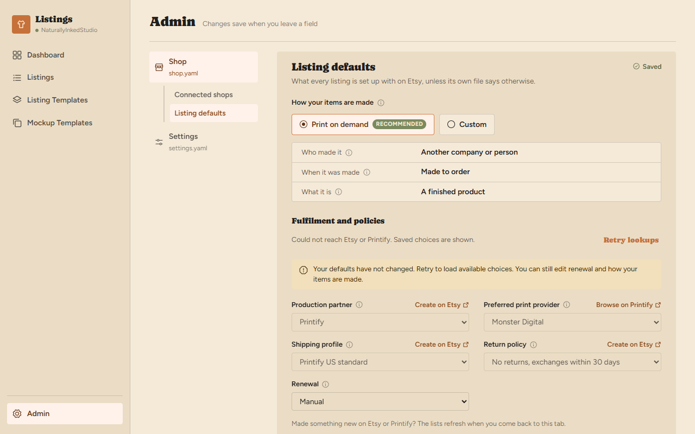

While a lookup runs, show its busy state and avoid duplicate refresh requests.
On failure keep the saved choice visible and disable the affected selector
until choices are available; independent local controls remain usable. Retry
lookups re-requests the lists without saving defaults. A saved option missing
from a successful lookup also stays visible with an explanatory warning; never
silently choose the first result. Etsy lookup freshness follows ADR-0033.

## AI providers, models and list refresh

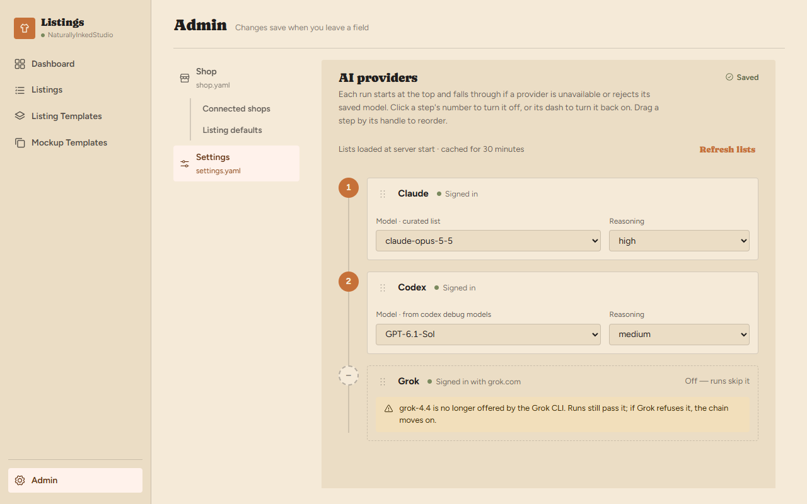

Enabled rows are numbered in fallback order. Disabled rows show a dash and do
not consume an order number. Click the number to turn a provider off or its
dash to turn it on. Turning it off retains its model, effort and position for
later. Attempting to turn off the last enabled provider leaves it on and shows
At least one provider stays on. A provider omitted from YAML appears as an off
row that the seller can enable.

Drag by the handle and release on another row to reorder. A focused handle's
Up/Down arrows perform the same move. Dropping in place or moving beyond an end
does not save. Reordering disabled rows retains their position for re-enabling.
Do not make dragging the model selector or number toggle reorder a row.

Model and Reasoning change the provider's choice for all tasks, starting with
the next run. Account default omits the corresponding CLI flag, rather than
storing the label as a model id or effort. The fixture's empty model string and
`Default` effort label must be mapped to the optional configuration fields.
An off provider retains its choices even though its selectors are hidden.

Keep a saved model or effort that discovery no longer offers. Show the saved
choice with a warning, allow replacement, and still pass it to the CLI on a run.
A CLI rejection of that choice permits fallback. Do not treat every generation
failure as a reason to fall through. The prototype renders a stale model warning;
production must handle stale effort values too, and derive Codex efforts from
the selected model's discovered capabilities. See
[ADR-0056](../../adr/0056-configure-ai-providers-per-workspace.md).

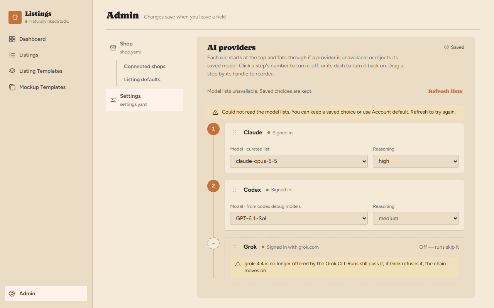

Attempt model discovery at server startup and cache results for 30 minutes.
Refresh lists explicitly requests new discovery and shows Refreshing while
pending. It does not save provider configuration or start generation. Keep
saved values and Account default available on discovery failure. Refreshing
successfully updates available choices and their status without replacing a
saved selection. The mockup's 800 ms recovery is a timer, not a CLI invocation.

## AI time limits

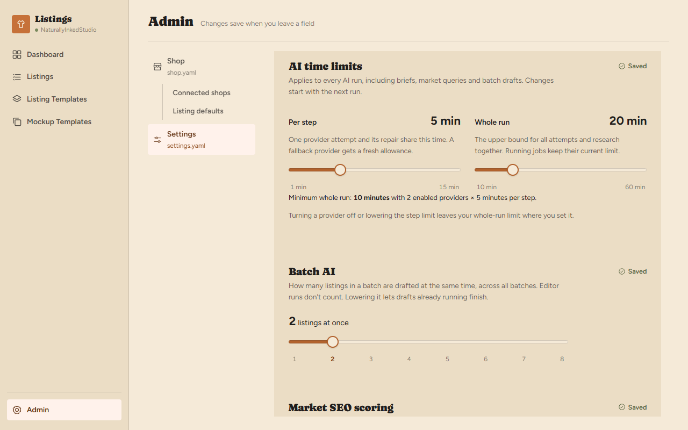

Both sliders use whole minutes. Per step ranges from 1 to 15, default 5; Whole
run ranges from 5 to 60, default 20. Dragging updates the displayed values live.
Save once the action completes, with equivalent keyboard and blur handling.
Their keys are `settings.yaml` → `ai.step_limit_minutes` and
`ai.run_limit_minutes`.

Whole run has a dynamic minimum of `max(5, enabled providers × per-step minutes)`.
Moving below that minimum is impossible through the slider. Raising Per step
or enabling a provider recalculates the minimum immediately. If necessary it
raises Whole run and displays the reason. Save the triggering change and the
raised limit together, so neither persisted document violates the relationship.

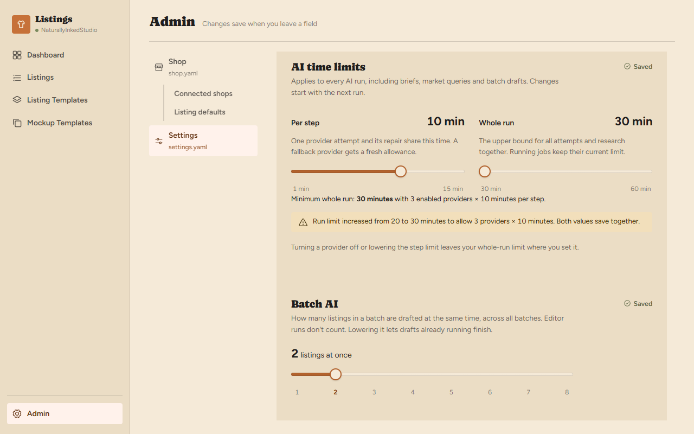

For example, three enabled providers at ten minutes require at least thirty
minutes. Lowering Per step or turning a provider off relaxes the minimum but
keeps the seller's chosen Whole run value. The notice describes the automatic
increase; changing settings does not resize an active run's captured limits.

The scope is every AI entry point, including brief drafting, market queries
and batch drafts. One provider attempt and its repair share the step budget.
Fallback gets a fresh allowance within the remaining run budget. Research and
successive tasks still share the whole-run cap. The provider-count floor is a
configuration rule, not a guarantee that every task gets every full allowance.
Runtime semantics belong to [ADR-0057](../../adr/0057-bound-ai-attempts-and-runs.md).

## Batch AI and market scoring

Batch AI is the lower panel in the time-limit screenshot. Its slider ranges
from 1 to 8 in whole listings, shows the value while moving, and saves the final
value on action completion. The configuration default is 1; the screenshot's
2 is a fixture. `settings.yaml` → `batch_ai.concurrency` governs batch rows
across all batches. The next dispatch reads it. Lowering it lets already
running drafts finish; manual editor runs do not consume this allowance.

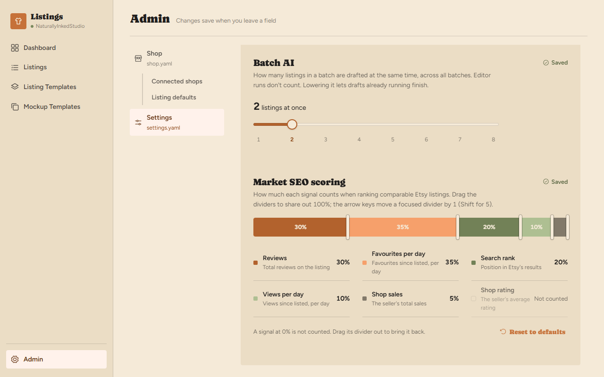

Dragging a market divider transfers weight only between its two neighboring
metrics. Other shares stay fixed and the total stays 100%. Movement stops at
the neighboring dividers, allowing either adjacent metric to reach zero.
A focused divider moves by one percentage point with Left/Right, or five with
Shift held. Pointer release completes the drag and saves; keyboard moves also
save the resulting percentages without duplicate completion writes.

Zero means Not counted in the legend, not a removed metric. Its divider stays
reachable so the seller can restore a share. When several dividers overlap,
the prototype waits for a small directional move: left chooses the leftmost
divider, right the rightmost. Keep keyboard access to every overlapping handle.

The six shares map to `market_seo.weights` in the metric order shown. Existing
nonnegative relative weights normalize for display without writing on load.
After an edit save integer percentages totaling exactly 100. Normalization must
not make a small or zero share negative through rounding; `toShares` is a simple
fixture helper, not a validated production normalizer.

Reset to defaults writes 30/30/20/10/5/5 in metric order and is disabled when
already at those values. It resets only market weights, leaving concurrency,
providers and time limits unchanged. Editing the weights affects later research;
it does not rerank an already retained proposal or start an AI run.

## Invalid files and conflicting saves

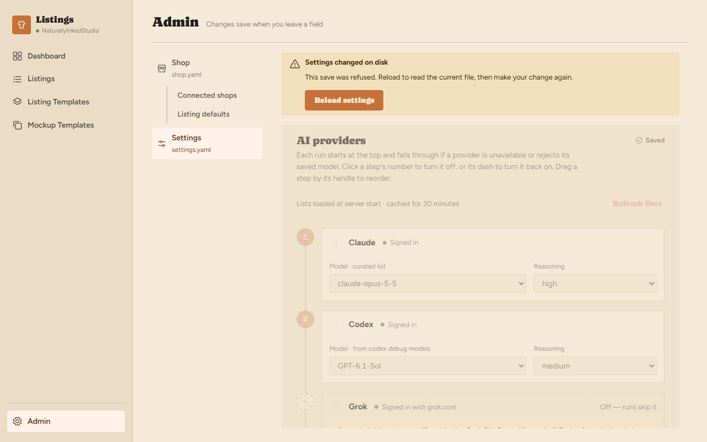

A conflicting save leaves the external file untouched and shows Settings
changed on disk. Disable edits to that file until Reload settings fetches its
current contents and revision. Reload replaces the stale displayed settings;
it does not reapply the refused edit. A settings conflict need not disable Shop,
which has its own file and revision. Apply the same rule to shop-file conflicts.

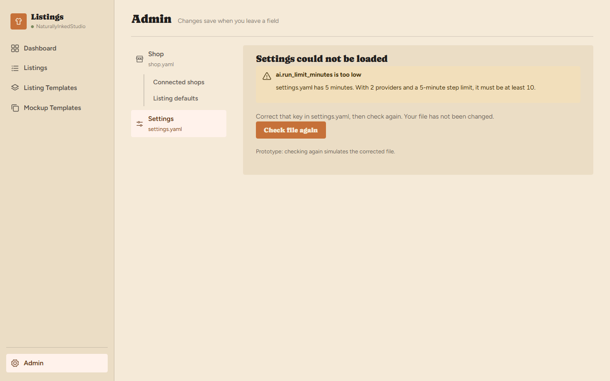

A malformed or invalid settings file refuses to load and names the file, dotted
key, bad value and correction where available. Do not show default controls as
though the file loaded successfully. Check file again rereads and validates the
file after the seller fixes it. The prototype button simulates a corrected file;
production must keep the error visible if the next read is still invalid.

Unknown keys/providers, duplicate provider names, no enabled providers and
invalid limit relationships follow this refusal rule. Missing optional files
or keys use documented defaults, which is different from ignoring invalid data.

## What the production implementation must finish

The mockup demonstrates the approved interactions in memory. Its timer-based
save/discovery states, injected remote options, `tier` flag and fixture
connection status are not application operations. Shop selectors currently
signal a save on change; production follows the agreed blur-save contract.
The currency dialog also needs the explicit-price copy correction described
above. Preserve these distinctions when copying code.

Use real server responses for validation, file revisions, retries, discovery
and connection state. Announce saving/errors and automatic limit increases
without moving focus away from the control. Provide labeled controls, visible
focus, accessible divider values, dialog focus containment and return, and
Escape dismissal. Use existing app primitives where they already provide this.

Compare each implemented state with the corresponding screenshot at its
captured viewport, then check nearby widths and keyboard use. The screenshots
are the approved desktop reference; they do not prove responsive layout,
dark-theme rendering, server persistence or accessibility. Run the checks and
behavioral cases in the plan's PR exit conditions rather than treating a matching
image as completion.

To refresh the reference images after an approved design amendment, run
`npx marver shot --scene admin-shop --scale 1 --json` from `src/ui`. Copy the
matching light-theme PNGs into this document's `screenshots/` directory and
review them. Each filename here corresponds to
`admin-shop/<filename-without-extension>/d-revised`. Update this document and
the capture date in the same change; do not replace approved references with
an unreviewed implementation screenshot.
