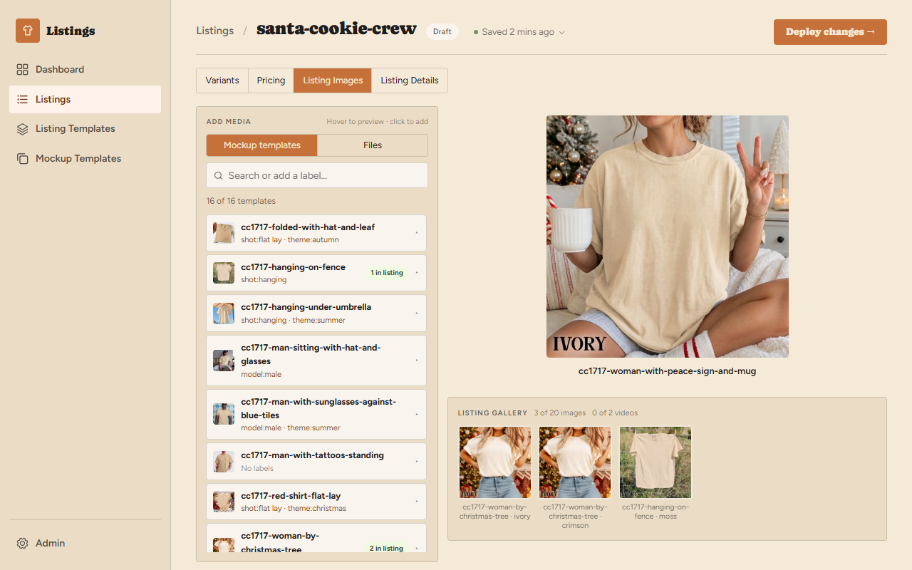
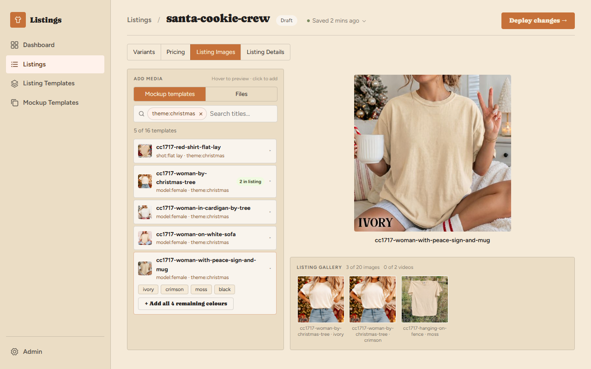
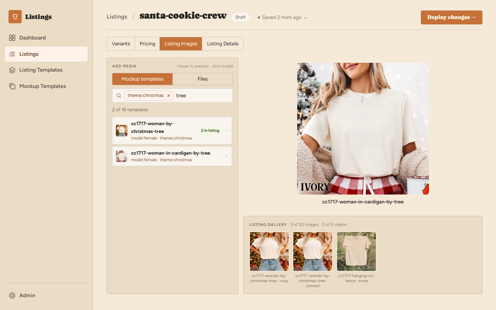
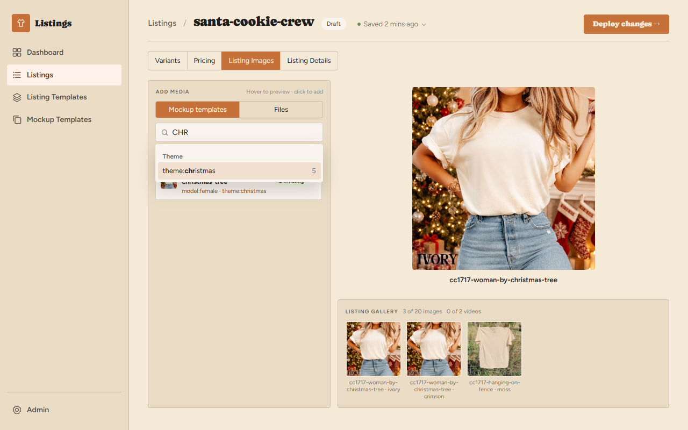
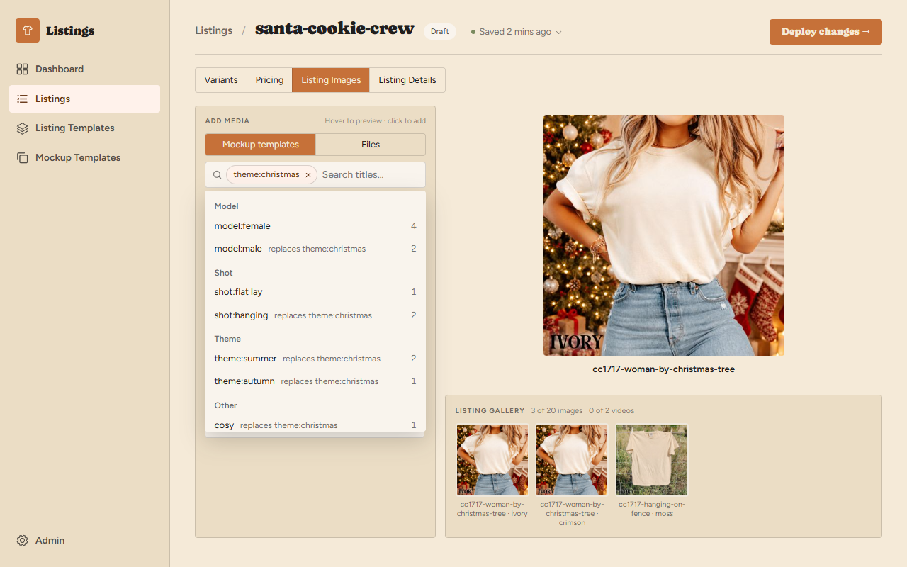
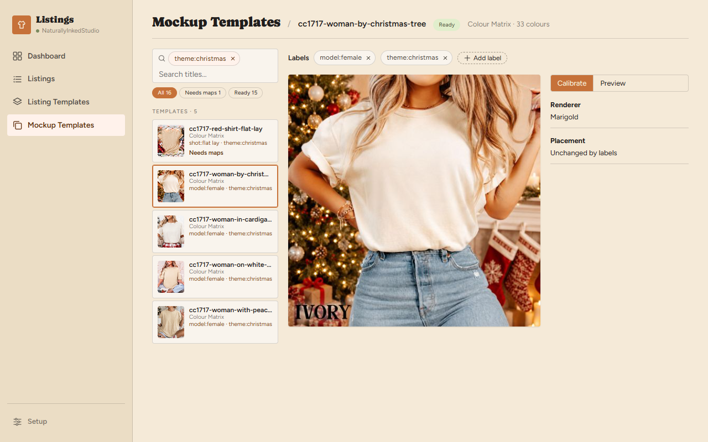
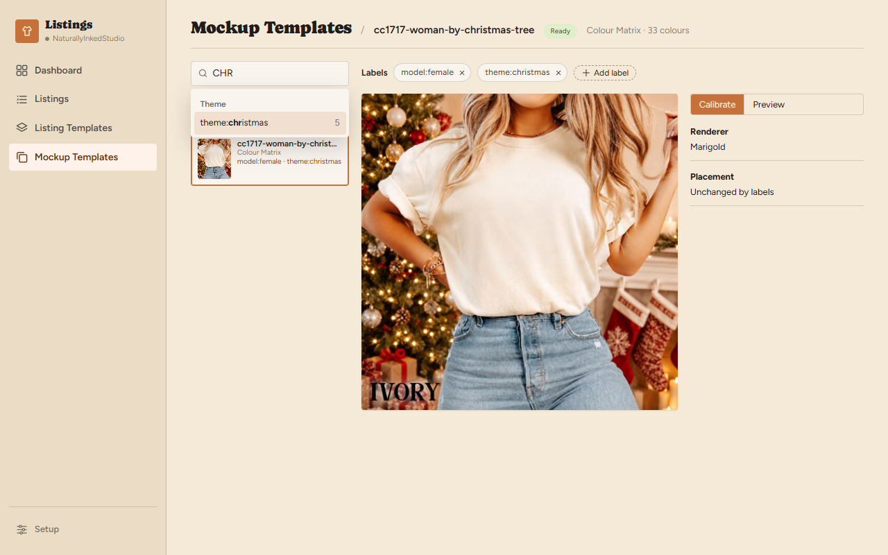
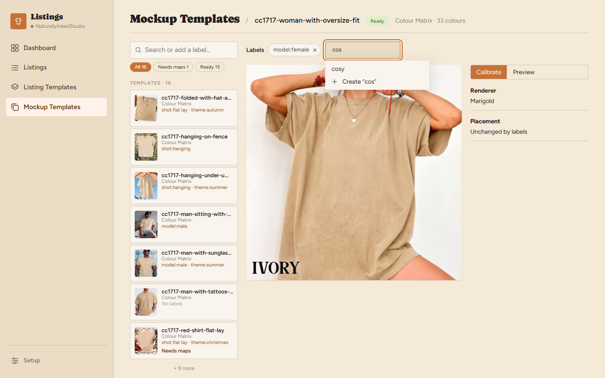

# Mockup template labels interactions and prototype reference

Status: design approved 2026-11-06 (round 4). This document records the
behaviour a screenshot cannot explain and points to prototype code an
implementation agent can copy. The [specification](spec.md) owns the
requirements: label rules, storage, the render hash, saving and search. Where
this document and the spec disagree, the spec wins and this document is
corrected.

The approved source is two boards. **Find templates on a listing** comes from
[`src/ui/design/scenes/listing-template-filter/`](../../../src/ui/design/scenes/listing-template-filter/)
and **Mockup template labels** from
[`src/ui/design/scenes/template-labels/`](../../../src/ui/design/scenes/template-labels/).
Both use the shared search box in
[`src/ui/src/components/LabelSearch.tsx`](../../../src/ui/src/components/LabelSearch.tsx).
Run `npx marver dev` from `src/ui`, open the printed URL and select a board.
Every frame is live, so type in the search boxes directly. The
`listing-template-filter-v1` to `-v3` and `template-labels-v1` and `-v2` scenes on
the Archive board are earlier rounds, not implementation targets.

Screenshots below are PNGs captured from the approved frames on 2026-11-06 at
1280 × 800, light theme, scale 1. Use the images for visual comparison and the
prose for behaviour. The listing `santa-cookie-crew`, its colours and every
label on a template are fixtures. The templates and their photos are real.

## Where the prototype implements each element

Paths link to source; names identify components or functions in those files.
The prototype holds everything in memory. Production components get their own
data and saves.

| Element | Prototype implementation | Useful parts to copy |
|---|---|---|
| Search box with pills | [`LabelSearch.tsx`](../../../src/ui/src/components/LabelSearch.tsx), `LabelSearch` | The whole component. The caller owns `on` and `query` and applies them to its own list. |
| Which labels the dropdown offers | `LabelSearch.tsx`, `optionsFor`, `groupOf` | Matching, counts, the `swap` flag and the group and sort order. |
| Group headings | `LabelSearch.tsx`, the `grouped` and `startsGroup` values | A heading is drawn where the group changes, in the same flat list the arrow keys walk. |
| Keyboard handling | `LabelSearch.tsx`, `keys` | Arrow wrap-around, Enter, Escape, Tab and Backspace. |
| Dropdown closing | `LabelSearch.tsx`, the `mousedown` effect and `close` | It closes on outside clicks and Tab, not on blur, so a click on an option still lands. Every close clears the highlight. |
| Search box styles | [`LabelSearch.css`](../../../src/ui/src/components/LabelSearch.css) | Semantic tokens only. The `input.label-search__field` rule exists to cancel the app's global text-input styles. |
| Listing locator | [`_SuggestedLocator.tsx`](../../../src/ui/design/scenes/listing-template-filter/_SuggestedLocator.tsx), `SuggestedScreen` | The result line and how the box drives the list. Fold these into the real `MediaLocator`. |
| Template row with labels | [`_ImagesScreen.tsx`](../../../src/ui/design/scenes/listing-template-filter/_ImagesScreen.tsx), `TemplateRow`, `.lf-tags` | The labels line. It replaces the kind line in the real `LocatorTemplate`. |
| Images tab chrome | `_ImagesScreen.tsx`, `ImagesScreen`, `LocatorShell`, `usePicker` | **Do not copy.** These are static stand-ins for `ImagesTab`, `MediaLocator` and `MediaReel`. |
| Rail | [`_RailScreen.tsx`](../../../src/ui/design/scenes/template-labels/_RailScreen.tsx), `RailScreen`, `RailRow`, `.tl-rail-tags` | The search box wiring and the labels line on each row. Fold these into the real `TemplateRail`. |
| Label bar on the workbench | `_RailScreen.tsx`, `AddLabel`, `.tl-labelbar`, `.tl-combo`, `.tl-reason` | Chips, Add label, suggestions, Create and the refusal message. |
| Label rules | `_RailScreen.tsx`, `tidied`, `refusal` | The client-side check and its messages, which the server repeats. |
| Waiting for the save | `_RailScreen.tsx`, `stage` | **Do not copy.** A timer stands in for the calibrator's autosave so the chip can be seen arriving late. |
| Workbench chrome | `_RailScreen.tsx`, the `app__main` block | **Do not copy.** The photo and inspector are stubs. |
| Fixtures | [`template-labels/_fixtures.ts`](../../../src/ui/design/scenes/template-labels/_fixtures.ts), [`listing-template-filter/_fixtures.ts`](../../../src/ui/design/scenes/listing-template-filter/_fixtures.ts) | `asTag` maps the fixture labels to saved tags, and `cosy` stays plain to show the Other group. |

## Prototype map

All frames on a board are one component in different states, not separate
pages, so they carry no play-mode links.

```
Search box
  click, or Down ─────────────► dropdown lists every label not yet a pill
  type, text matches a label ─► dropdown lists matches, nothing highlighted
  type, text matches no label ► no dropdown, plain title search
Dropdown open
  Down / Up ──► moves the highlight through all groups, wrapping at both ends
  Enter on a highlight, or click ──► text clears, label becomes a pill
  Enter with no highlight ──► dropdown closes, text stays as a title search
  Esc, Tab, or click outside ──► dropdown closes, highlight clears, text stays
```

## One search box



The Listing Images locator and the Mockup Templates rail use the same control,
and it opens empty on both. Pills filter by label and plain text narrows the
result by title. Two pills mean both labels, never either.



Title search sits on top of the labels rather than beside them. With
`theme:christmas` on, typing `tree` shows the two Christmas templates with `tree`
in their names, not every template with `tree`. An earlier round searched all
templates regardless of the filter. It was dropped because a search should refine
what is on screen.



Plain text searches template names only, because a label match is offered in the
dropdown instead. The placeholder reads "Search or add a label…" with no pills
and "Search titles…" with at least one.

## Picking a label



Any text contained in a label opens the dropdown, from the first letter, and
that includes the prefix, so `theme` finds every `theme:` label. The matching
part of each label is bold, and each row shows how many templates would remain.
Text that matches no label opens nothing and stays plain text.

Nothing is highlighted until the seller presses Down. If the first option were
highlighted, Enter on `chr` would turn a title search into a label, and there
would be no way to search titles for text that also matches a label. The list
filters by title while the seller types, so `chr` shows only
`woman-by-christmas-tree` until a label is picked.

| Input | Result |
|---|---|
| Click the box, or Down | Opens the dropdown. With no text it lists every label not already a pill. |
| Down, Up | Moves the highlight through all groups and wraps at both ends. |
| Enter on a highlighted label | Adds the pill, clears the text and closes the dropdown. Focus stays in the box. |
| Enter with nothing highlighted | Closes the dropdown and keeps the text. |
| Click a label | Same as Enter on it. |
| Esc | Closes the dropdown and clears the highlight. The text stays. |
| Tab | Closes the dropdown and clears the highlight, and focus moves on. |
| Backspace in an empty box | Removes the last pill. |
| × on a pill | Removes that pill. Focus returns to the box. |

**Keyboard and focus.** Closing the dropdown any way clears the highlight, so Enter
cannot pick a row left over from before. Tab closes it so it does not stay over the
list once focus has moved on. Backspace and × clear the highlight too, because what
is on offer changes. The highlighted row scrolls into view inside the dropdown. Down
with nothing to offer highlights nothing. The field is a combobox with
`aria-autocomplete="list"`; `aria-controls` names the listbox and
`aria-activedescendant` the highlighted row only while they exist, and ids come from
`useId`.



**Groups.** Headings are the text before the colon, capitalised, A to Z, with
plain labels under Other last. With no prefixed label on offer the list has no
headings. Pills, rows and chips always show the full text, such as
`theme:christmas`.

**Labels that would leave nothing.** A label that shares no template with the
current pills reads "replaces theme:christmas", shows its own total, and replaces
the pills when picked. These rows sort after the labels that narrow, within their
group.

Only labels in use appear, because there is no fixed list to offer. A label for
photos with several people appears once a template holds one.

## Listing Images

The result line under the box reads "5 of 16 templates". The filter is always the
seller's own, so there is no control for reaching filtered-out templates. Removing
a pill brings them back.

Pills and text live in the editor's view memory, like the locator's other state.
They survive moving to Pricing and back, a refresh, and leaving and returning in the
same browser tab, and each listing has its own. Switching the panel to Files keeps the pills and clears the
text, and the pills are there on return. Rows show the template's labels, or "No
labels", in place of the kind line. Hover, opening a row and the colour chips work
as they do today.

## Mockup Templates rail



The search box replaces the rail's search input and sits above the status pills.
The status and kind pills stay as they are, and the frames omit the kind pills for
space. Both apply first, so the dropdown's labels and counts cover only what they
leave.

Switching template keeps the pills and text. Leaving the page drops them. Rows
gain a line showing labels, or "No labels".



Pills wrap inside the 228px box, and the text field keeps a minimum width of 90px.

## Tagging a template



The Labels bar sits above the template's photo, on both Calibrate and Preview, and
is hidden until the template has a kind. Each label is a chip with a ×. **Add
label** turns into a field with suggestions from labels on other templates, up to
six, excluding those this template holds.

Enter adds the first suggestion, or with no suggestion creates the typed text,
which **Create "cos"** does when clicked. Escape closes the field. The text is
tidied as the spec describes, so `Road  Trip` becomes `road trip`.

A chip appears or disappears only when the save lands, after the autosave
debounce. "Saving…" shows beside the bar in the prototype; production uses the
app's existing save status. Quick edits land together.


A label that breaks a rule keeps the typed text, and the reason replaces Create.
Enter does nothing until the text is valid. At 10 labels, Add label is disabled,
with "Templates hold up to 10 labels" as its tooltip. In production that message
must also be visible without hovering.

## What the production implementation must finish

The spec owns the backend: storage, the hash exception, the save and its tests.
On the frontend:

- **Filter state in view memory.** `MediaLocator` already keeps its mode, query and
  open row with `useViewState`. Add the pills as another slot under the same
  `scope`, so listings and listing templates each keep their own.
- **Saved labels, not the draft.** The Labels bar reads the session's saved config.
  The prototype's `stage` timer only imitates this.
- **Save held by a preview.** The autosave can wait behind a pending preview, so a
  chip can take longer than the debounce. The save status must stay visible.
- **Files mode.** The prototype does not wire the switch to Files. Keep the pills
  and clear the text, as the spec says.
- **Calibrated templates only.** The real locator lists calibrated templates, so
  its labels, counts and the "of N" total must cover those alone.
- **Not prototyped:** save failure and conflict states, and dark-theme screenshots.
  The app's stylesheet has no dark theme, so the canvas renders these frames the
  same in both modes.
