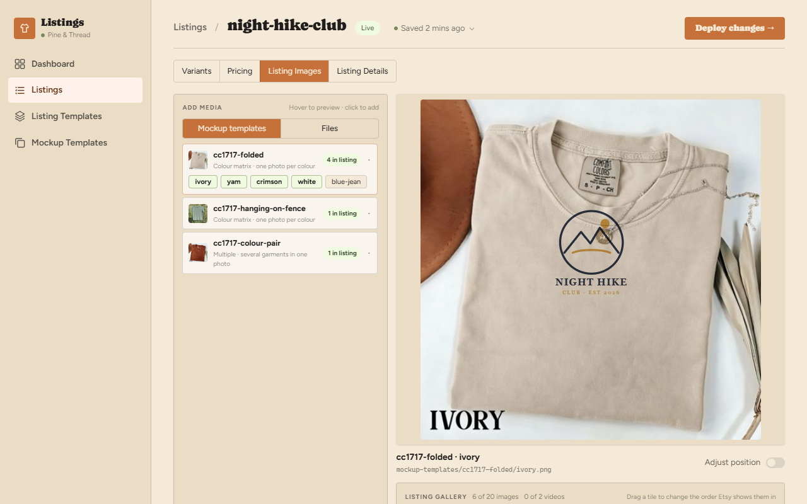
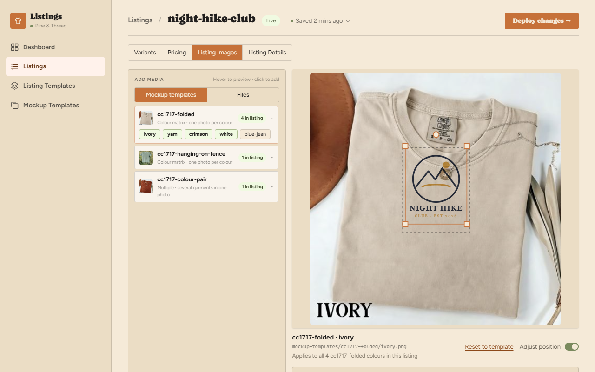
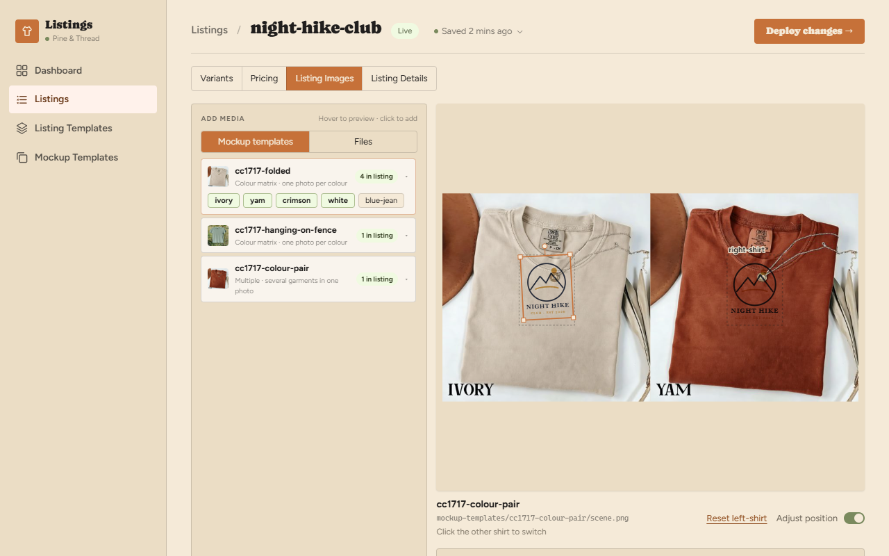
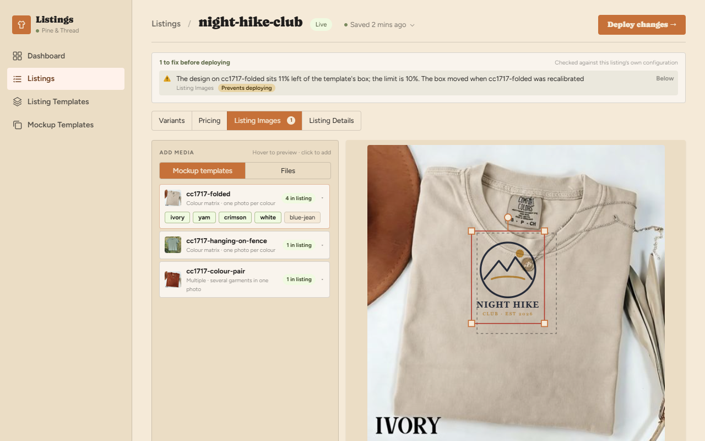
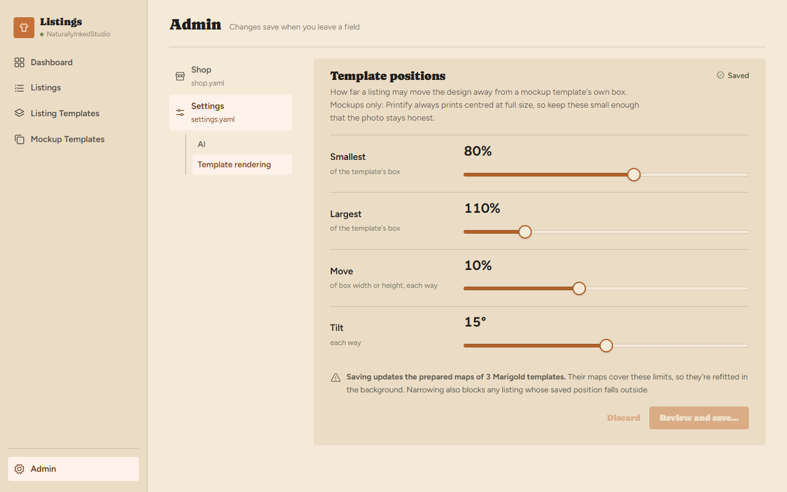
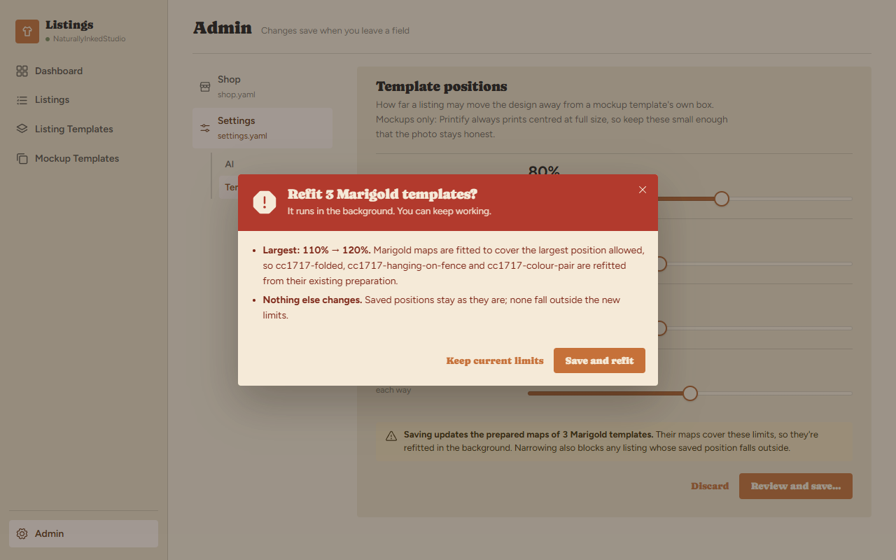

# Template positions interactions and prototype reference

Status: design approved 2026-11-02 (round 3). This document records the
behaviour a screenshot cannot explain and points to prototype code an
implementation agent can copy. The [specification](spec.md) owns the
requirements: the `template_positions:` file shape, validation, rendering and
the Marigold spike. Where this document and the spec disagree, the spec wins
and this document is corrected.

The approved source is the **Template Positions** board, built from two scenes:
[`src/ui/design/scenes/template-positions/`](../../../src/ui/design/scenes/template-positions/)
(listing editor) and
[`src/ui/design/scenes/template-positions-settings/`](../../../src/ui/design/scenes/template-positions-settings/)
(Admin settings). Run `npx marver dev` from `src/ui`, open the printed URL,
select the board and press **P** for play mode. `template-positions-v1`,
`-v2` and their settings twins on the Archive board are earlier rounds, not
implementation targets.

Screenshots below are checked-in PNGs captured from the approved frames on
2026-11-02 at 1280 × 800, light theme, scale 1. Use the images for visual
comparison and the prose for behaviour. Listing, template and colour names,
counts and pose values are fixtures, not production defaults.

## Where the prototype implements each element

Paths link to source; names identify components or functions in those files.
The prototype is fixture-driven. Production components get their own data,
saves and preview requests.

| Element | Prototype implementation | Useful parts to copy |
|---|---|---|
| Interactive stage: move, resize, tilt, nudge | [`_PositionStage.tsx`](../../../src/ui/design/scenes/template-positions/_PositionStage.tsx), `PositionStage`, `move`, `start`, `nudge` | Pointer capture, handle layout (four corner squares, a round tilt handle on a stem above the top edge), screen-to-photo mapping via `getScreenCTM`, clamping on every change, arrow-key nudge. |
| Ghost of the template's box | `PositionStage`, `ghost` prop, `.tp-ghost` | Dashed outline drawn only while editing and only when the listing has a position. |
| Dimmed, click-to-select placements | `PositionStage`, `onSelect`, `.tp-box--off`, `.tp-tag` | Other placements of a `multiple` template: dashed, labelled with the placement ID, hover tint, click selects. |
| Out-of-limits outline | `PositionStage`, `invalid` prop, `.tp-box--invalid` | Solid danger-red box. |
| Pose maths | [`_geometry.ts`](../../../src/ui/design/scenes/template-positions/_geometry.ts), `clampPose`, `poseTransform`, `corners`, `isIdentity` | The editing model (scale, offset, tilt) and conversion to the four stored corners. See *Geometry* below before reusing. |
| Adjust position switch | [`_panes.tsx`](../../../src/ui/design/scenes/template-positions/_panes.tsx), `PositionSwitch` | The app's existing `.switch` control with a text label. In production it toggles state; the prototype's `goto` is play-mode navigation only. |
| Preview foot | `_panes.tsx`, `Foot` | Title and path on the left (path truncates); Reset link and switch grouped on the right (`.tp-controls`). |
| Single-placement pane | `_panes.tsx`, `PositionPane` | Wiring of stage, foot, Reset and the colour-matrix scope note. |
| Multiple-template pane | [`03-multiple.tsx`](../../../src/ui/design/scenes/template-positions/03-multiple.tsx) | Per-placement pose state, selection, `Reset <placement-id>`. |
| Out-of-limits pane | [`04-out-of-range.tsx`](../../../src/ui/design/scenes/template-positions/04-out-of-range.tsx) | Note line, Fit within limits, Reset, and the issues-banner row. |
| Gallery badge | [`_EditorFrame.tsx`](../../../src/ui/design/scenes/template-positions/_EditorFrame.tsx), `Reel`, `PositionGlyph`, `.tp-tile-badge` | Small move-arrows badge on reel tiles whose template this listing positions. Add it to the real `MediaReel` tile. |
| Editor chrome | `_EditorFrame.tsx`, `EditorFrame`, `Locator`, `Reel` | **Do not copy.** The head, banner and tabs are the app's own components; the locator and reel are static copies of `MediaLocator` and `MediaReel` markup with fixture photos. |
| Admin nav with Settings subsections | [`_LimitsPanel.tsx`](../../../src/ui/design/scenes/template-positions-settings/_LimitsPanel.tsx), `AdminNav` | Settings gets the same `.s-subnav` that Shop uses. Fold into the real `Nav` in `src/ui/src/pages/admin/AdminPage.tsx`. |
| Limits panel | `_LimitsPanel.tsx`, `LimitsPanel`, `Slider` | Four `.sp-slider` rows, label/hint column, note, Discard and Review and save. |
| Confirmation dialog | [`02-confirm.tsx`](../../../src/ui/design/scenes/template-positions-settings/02-confirm.tsx) | Reuses the shipped currency dialog's classes (`sa-scrim`, `sa-modal sp-modal`, `sp-modal__alarm`, `sp-modal__facts`, `sa-modal__foot`). |
| Styles | [`_positions.css`](../../../src/ui/design/scenes/template-positions/_positions.css), [`_limits.css`](../../../src/ui/design/scenes/template-positions-settings/_limits.css) | Semantic tokens only; both themes work. `.tp-chip*` rules are leftovers from round 2 and are unused. |

## Prototype map

```
Editor:   1 Entry selected ──switch on──► 2 Adjusting ──switch off──► 1
          1 or 2 ──colour-pair reel tile──► 3 Multiple ──ivory reel tile──► 1
          4 Outside the limits ──Fit within limits──► 2
                               ──Reset to template / switch off──► 1
Settings: 5 Template rendering ──move a slider, Review and save──► 6 Confirm
          6 ──Save (and refit) / Keep current limits / ×──► 5
```

Frame 4 is a second entry point, not reachable from frame 1: it is the state a
listing is in after its template was recalibrated. In production all four
editor frames are one pane in different states, not separate pages.

## Entry and the Adjust position switch



Selecting a template entry in the reel previews it as today. The preview foot
gains an **Adjust position** switch on the right. With the switch off, the
stage shows the composite at the listing's position, or at the template's own
box when the listing has none. Nothing on screen reports scale, offset or tilt,
and nothing distinguishes a custom position from the template's except the
gallery badge (below).

The switch appears for template entries only, never for file refs or videos.
It is per pane, not saved: selecting another reel tile turns it off. Turning it
off ends editing; it never discards or reverts anything.

## Adjusting



With the switch on:

- **Move:** drag inside the box.
- **Resize:** drag any corner handle. Resizing is uniform about the box centre.
  There is no per-axis stretch and no free corner.
- **Tilt:** drag the round handle above the top edge. Tilt is about the box
  centre in whole degrees.
- **Nudge:** the box is focusable. Arrow keys move it 1% of the template box's
  width or height; with Shift, 5%. Focus shows a thicker outline.
- **Limits:** every change is clamped to the settings limits. A handle simply
  stops. There is no message, colour change or readout at a limit.
- **Ghost:** while the listing's position differs from the template's, the
  template's own box is drawn as a dashed outline behind the handles.
- **Scope note:** for a `colour-matrix` template the foot's note line reads
  "Applies to all N <template> colours in this listing", because one position
  serves every colour (spec, *Scope and decisions*).
- **Reset to template:** a text link, shown only while editing and only when
  the listing has a position. It removes the listing's entry for that template
  (or placement); it does not write a copy of the template's box. The stage
  snaps back and the ghost disappears.

**Saving.** There is no Done or Cancel. A position saves through the editor's
normal save path, once per completed gesture: pointer release after a drag, or
a nudge after a short debounce (about 400 ms). The editor head's save status
behaves as for any other field. A position equal to the template's box is
written as no entry.

**Preview while dragging.** The real composite comes from the server
(`GET /api/listings/{name}/scene-preview`), which renders the *saved* listing.
During a drag, draw the handles and a flat overlay of the artwork at the draft
pose (the prototype's `.tp-print` multiply layer is the reference). When the
save lands, the preview URL changes with the saved signature and the real
composite replaces the overlay. Never show the overlay with the switch off.

## Multiple templates



Each placement of a `multiple` template has its own position. With the switch
on, the selected placement shows handles; the others are dashed, labelled with
their placement ID and clickable. Clicking one selects it. The note line reads
"Click the other shirt to switch" (production: "Click another placement to
switch" when there are more than two). Reset reads `Reset <placement-id>` and
affects only the selected placement. The initially selected placement is the
first in the template's order. There is no placement picker.

## Gallery badge

A reel tile whose template has a position in this listing shows a small
move-arrows badge in its bottom-right corner, with the title "This listing
positions the design on this template". For a colour-matrix template every
colour's tile shows it. It is the only indication outside Position mode.

## Position outside the limits



When `plan` refuses a stored position (spec, *Validation* rules 1–4), the
refusal appears in the editor's issues banner as a blocking row on Listing
Images, using the spec's message. Selecting the affected entry shows:

- the stored box outlined in solid red, with handles, and the ghost;
- the note line "Outside the limits since the template's box moved" (for a
  non-similarity box: "Not a plain move, resize or tilt of the template's box");
- **Fit within limits**, a primary button, which replaces the stored box with
  the nearest allowed one (fit the similarity, then `clampPose`), saves it and
  leaves the pane in Position mode;
- **Reset to template**, which removes the entry;
- the switch, already on.

A key naming a template not in `media:` or a missing placement has no stage to
show it on. Its banner row's action removes the stale key.

## Marigold templates

Marigold positions use a fit per position (spec, *Marigold (option B)*). After
a position saves, its fit runs in the background (spike: about 1–6 s). Until
it is ready the stage keeps the drag overlay and then its normal loading
treatment while the preview route waits; there is no progress card and the
switch stays enabled. A limits change that needs new inference shows nothing
in the editor either; previews of affected scenes simply wait.

## Settings: Template rendering



Admin's Settings entry gains a subnavigation exactly like Shop's: **AI** (the
existing panels, unchanged and in their current order) and **Template
rendering** (this panel). Opening Settings selects AI. The selection stays out
of the URL, as for Shop.

The panel is titled **Template positions** and holds four sliders:

| Row | Range | Step | `settings.yaml` |
|---|---|---|---|
| Smallest (of the template's box) | 50–100% | 5 | `template_positions.scale.min` |
| Largest (of the template's box) | 100–150% | 5 | `template_positions.scale.max` |
| Move (of box width or height, each way) | 0–25% | 1 | `template_positions.offset` |
| Tilt (each way) | 0–30° | 1 | `template_positions.rotation` |

The value above each slider updates live. The note under the sliders is grey
while nothing has changed and becomes the amber warning once a value differs
from the saved one.

**Saving differs from the rest of Admin.** Every other Admin field saves on
blur; these do not, because widening them can run Marigold inference. Edits stay a draft
in the panel. **Discard** reverts the draft, and **Review and save…** opens the
confirmation; both are disabled while the draft equals the saved values.
Leaving the subsection or the page with a draft keeps it while the page stays
mounted (as Admin does for pending edits) and drops it on reload.



The confirmation lists:

1. each changed limit, old → new, and the Marigold templates whose
   preparation must run the model again to cover the wider limits, by name
   (none when narrowing; Photo warp templates are never listed);
2. which saved listing positions fall outside the new limits, by listing name,
   with "they will block deploying until edited". When none do, the bullet
   reads "Nothing else changes. Saved positions stay as they are; none fall
   outside the new limits."

**Save** writes `settings.yaml` through the same validated,
revision-checked save as the AI settings, closes on success and queues any
inference in the background. The dialog's title and primary button read
"Refit N Marigold templates?" / "Save and refit" only when inference is
needed; otherwise "Save new limits?" / "Save". A failure leaves the dialog open with the error. **Keep current
limits**, ×, Escape and the backdrop close without saving and keep the draft.
Focus moves into the dialog on open, stays inside it, and returns to Review
and save on close, as the currency dialog does.

The dialog reuses the currency dialog's alarm header. It is heavier than this
action needs; a lighter header is acceptable if the implementer has one to hand.

## What the production implementation must finish

- **Geometry in the box's own frame.** The prototype's templates have
  axis-aligned boxes, so it moves, scales and tilts in photo pixels. Production
  boxes are arbitrary quads: apply the pose in the template box's rectified
  frame (unit square scaled to its mean side lengths, so tilt stays rigid) and map through the template homography, as the spec's *Validation* section
  describes. Handles are drawn at the mapped corners. The real
  `src/ui/src/components/quadGeometry.ts` helpers (`moved`, `nudged`,
  `scaledAbout`) edit free quads for the calibrator and are not the right
  model here.
- **Stored shape.** Save the four absolute corners (`corners()` is the
  reference) under `template_positions.<template>.bounding_box`, or
  `…placements.<id>.bounding_box`. Load by decomposing the stored quad back to
  a pose.
- **Limits from settings.** The editor reads the limits from the workspace
  settings; the prototype hard-codes the defaults in `_fixtures.ts`.
- **Real previews.** Replace the faked composite with the scene-preview route
  and the drag overlay described above.
- **Real nav and saves** for Settings: fold `AdminNav` into the shipped `Nav`;
  the prototype's sliders save nothing and its counts are fixtures.
- **Not prototyped:** the calibrator's save warning listing listings that hold
  positions for a template (spec, *Recalibration*), the banner action that
  removes a stale key, and dark-theme screenshots (the styles use semantic
  tokens, so the canvas's dark mode renders them).
