# Workspace backup interactions and prototype reference

Status: design approved 2026-11-23 (round 4). This
document records the behaviour a screenshot cannot explain and points to the
prototype code an implementation agent can copy. The [specification](spec.md)
owns the requirements: the backup run, pausing jobs, the copy, warnings,
restore and the CLI. Where this document and the spec disagree, the spec wins
and this document is corrected.

The source is the **Admin · Workspace backup** board, built from
[`src/ui/design/scenes/workspace-backup/`](../../../src/ui/design/scenes/workspace-backup/).
Run `npx marver dev` from `src/ui`, open the printed URL and select the board.
Every frame mounts one stateful prototype at a different starting point, so the
whole flow clicks in place, timers included. The `workspace-backup-v1` to `-v3`
scenes on the Archive board are earlier rounds, not implementation targets.

Screenshots below were captured from the frames on 2026-11-23 at 1280 × 800,
light theme, scale 1. Use the images for visual comparison and the prose for
behaviour. Every run, size, time, path and file name in them is a fixture.

## Where the prototype implements each element

Paths link to source; names identify components or functions in those files.
The prototype holds everything in memory and fakes progress with timers.
Production components get their data from the server.

| Element | Prototype implementation | Useful parts to copy |
|---|---|---|
| App shell with the backup warning | [`_parts.tsx`](../../../src/ui/design/scenes/workspace-backup/_parts.tsx), `BackupShell`, `.bk-global`, `.bk-nav-dot` | The banner markup and the dot on Admin. Fold both into the real `AppShell`. |
| Admin nav with Backup under Settings | `_parts.tsx`, `AdminNav`, `.bk-subnav-backup`, `.bk-subnav-nested` | The third Settings item, its warning icon, and the nested pair of pages. |
| Status panel | `_parts.tsx`, `StatusPanel`, `.bk-status*` | Headline, detail, the running line, the two buttons, and the slot for a restore in progress. |
| Storage diagram | `_parts.tsx`, `StoragePipeline`, `.bk-flow`, `.bk-node`, `.bk-arrow` | The whole component. |
| History table | `_parts.tsx`, `History`, `.bk-table` | The fixed column widths, the result icons and the Kept as pills. |
| Progress bar | `_parts.tsx`, `Progress`, `.bk-bar` | The whole component. It is an ARIA `progressbar`. |
| Set up and Setup form | [`_prototype.tsx`](../../../src/ui/design/scenes/workspace-backup/_prototype.tsx), `SettingsForm` | Fields, the interval control and its hints, the password checks, destination rows and the read-only fields in edit mode. |
| Backups off | `_prototype.tsx`, `NotSetUp` | The copy and the single action. |
| Restore dialogs | `_prototype.tsx`, `RestoreDialog`, `RestoringDialog`, `RestoredDialog`, `RestoreStrip`, `restoreFigures` | The dialogs, the refusal of the live workspace path, and how progress figures are worded. |
| Changed files | `_prototype.tsx`, `ChangedFilesBanner`, `RepairDialog`, `.bk-changed*` | The file list and the repair confirmation. |
| Dashboard behind the banner | `_prototype.tsx`, `DashboardMock` | **Do not copy.** A static stand-in for `DashboardPage`. |
| Timers | `_prototype.tsx`, the `useEffect` blocks and `RUN_STEPS` | **Do not copy.** They stand in for server status. |
| Fixtures | [`_fixtures.ts`](../../../src/ui/design/scenes/workspace-backup/_fixtures.ts) | The shapes are a starting point for the status API: `BackupRun`, `Destination`, `BackupSettings`, `ChangedFile`. |

## Prototype map

```
Settings › Backup (off) ── Set up backups ──► Set up form
Set up form
  Cancel ─────────────────────────────────► Backups off
  Create and back up now (password ok, box ticked) ──► Status and history, first backup running
Status and history
  Back up now ──► running line steps through waiting, backing up, copying ──► new row at the top
  Restore…, or Restore… on a row ──► Restore dialog
  Edit setup, or nav Setup ──► Setup page
  Try again (failing) ──► backup runs; success clears the warnings
  Repair the iCloud Drive copy… (changed files) ──► Repair dialog
Restore dialog ── Restore to this folder ──► Restoring dialog
Restoring dialog
  Keep working ──► dialog closes, progress strip in the status panel ── Show ──► Restoring dialog
  Stop restore ──► note in the status panel
  reaches 100% ──► Restored dialog (or a note with Show, if closed)
Any other page, with a warning ── Open Backup ──► Status and history
```

## Where Backup lives

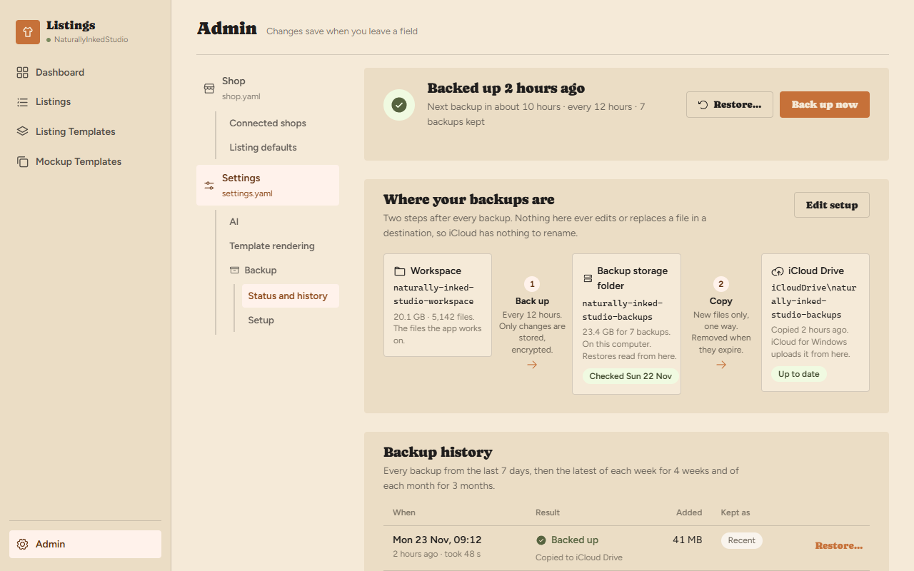

Backup is the third item under Admin › Settings, after AI and Template
rendering. Once backups are set up it has two pages nested beneath it:
**Status and history** and **Setup**. Clicking Backup opens Status and
history. Before set-up there is nothing nested, and the item reads "off".

When any warning applies, a warning icon sits at the right of the Backup item.

## Status and history

The page holds three panels, top to bottom.

1. **Status.** The headline says when the last successful backup ran. The detail
   says when the next one is due, the interval, and how many backups are kept.
   Restore… opens the restore dialog on the newest backup. Back up now starts a
   run straight away.
2. **Where your backups are.** Three boxes, workspace → backup storage folder →
   each destination, with step 1 (Back up) and step 2 (Copy) between them. Each
   box shows its folder name (the full path is the tooltip), what it holds, and
   a pill for its state. Edit setup opens the Setup page.
3. **Backup history.** Every run, newest first, including failures. A run that
   made a snapshot has Restore…; a failed run with no snapshot does not. "Kept
   as" names the retention bucket. The lede states the retention in words and
   follows the Setup values.

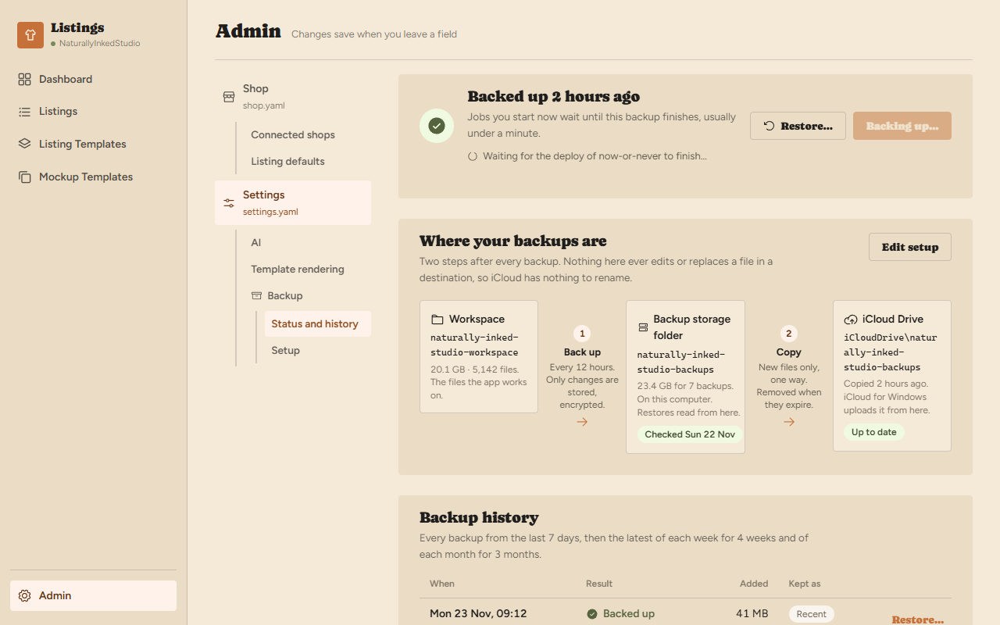

**A backup in progress.** Back up now is disabled and reads "Backing up…". A
line under the detail says what the run is doing:
- waiting for a named job to finish (spec, *Pausing jobs*),
- the files checked so far, out of the total,
- copying new files to each destination.

When the run ends, its row appears at the top of the history with a brief
highlight, and the status panel updates. The highlight is skipped under
`prefers-reduced-motion`.

## Set up and Setup

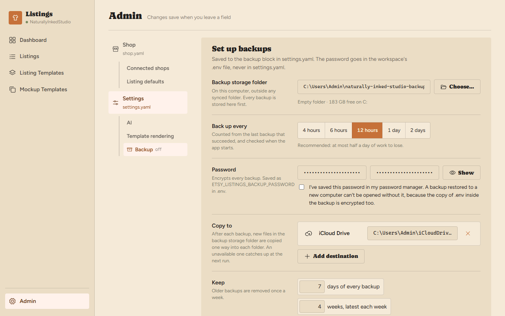

**Backups off** explains the feature in three points and offers Set up backups.
A note beside the button says that backups from another computer are
connected when their folder is added as a destination.

**Set up** is one form, saved with **Create and back up now**:

| Field | Behaviour |
|---|---|
| Backup storage folder | A path with Choose…. The hint under it shows whether the folder is empty and the free space on its drive. |
| Back up every | A segmented control: 4 hours, 6 hours, 12 hours, 1 day, 2 days. 12 is the default. The hint changes with the choice. |
| Password | Two fields and Show/Hide, which toggles both. Errors appear under them: under 12 characters, or the two don't match. |
| "I've saved this password…" | Must be ticked before Create is enabled. |
| Copy to | One row per destination: name, editable path, and × to remove. Add destination appends a row. With none, the hint warns that a failed disk loses the backups too. |
| Keep | Three numbers: days of every backup, weeks, months. Digits only. Zero is refused. |

Create saves the `backup:` block and the password (spec, *Configuration*),
creates the repository, and starts the first backup. The page switches to
Status and history with that backup running. Cancel returns to Backups off.

If a destination already holds a backup, Create connects it instead (spec,
*Set-up*). While it copies, the form keeps its buttons disabled and shows
"Connecting to the backup in <destination>… Copying it to this computer can
take a while." under the fields. When it is done, the page switches to
Status and history with the note "Connected to the backup in <destination>:
N snapshots." A password that does not open that backup is refused under the
form: "<folder> already holds a backup, and this password does not open it.
Enter that backup's password to connect it. Nothing was saved." Part of a
copy, two different backups and a storage folder that holds files are
refused the same way.

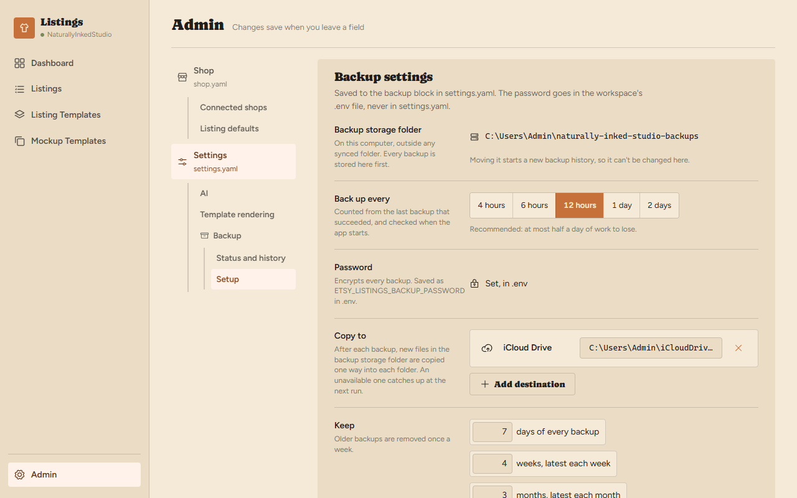

**Setup** is the same form after set-up, with two differences:
- The storage folder and the password are read-only, with the reason under the
  folder.
- The buttons are **Discard changes** and **Save**. Both are disabled until
  something changes. Save shows "Saved to settings.yaml · every N hours" at the
  top of the panel for a few seconds, and the page stays put.

## Warnings

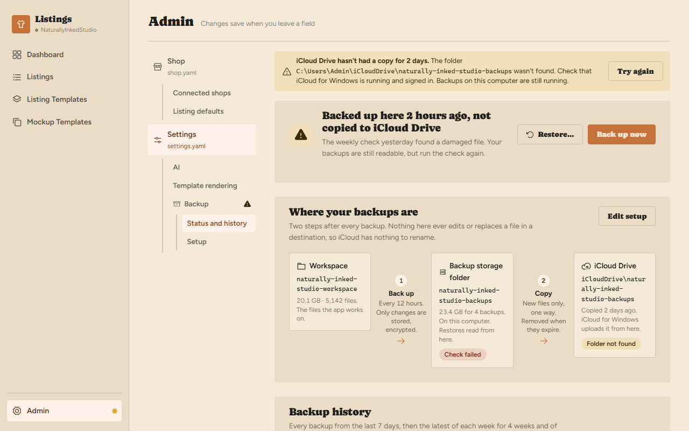

A warning shows in three places at once, until the problem clears.
1. **On Status and history**, a banner above the status panel says what is wrong
   and what to do, with one action. The status panel turns amber, and the
   diagram's affected box gets an amber or red pill.
2. **On the Backup item** in the Admin nav, a warning icon.
3. **Everywhere else in the app**, a banner at the top of the page and a dot on
   Admin in the sidebar.

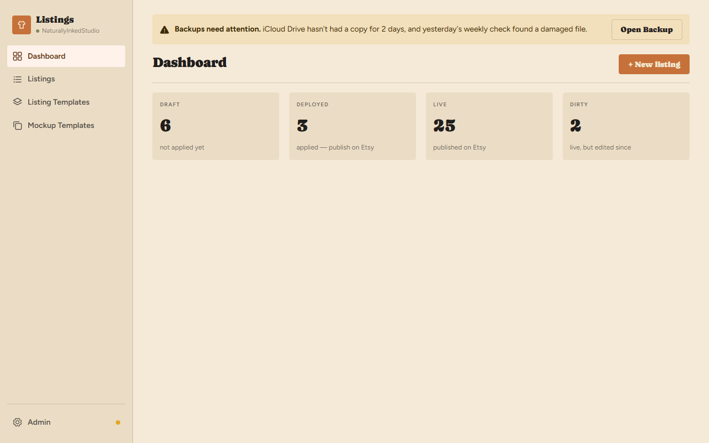

The banner elsewhere is one line and has an **Open Backup** button that goes to
Settings › Backup › Status and history. It cannot be dismissed (spec, *Status
and warnings*). It does not show on the Admin page, which has its own warnings.

Banner actions on the Backup page:

| Warning | Action |
|---|---|
| Destination unreachable, behind, or a run failed | **Try again** runs a backup now. Success clears the warning everywhere. |
| Changed or unexpected files in a destination | **Repair the iCloud Drive copy…** (see below) |
| Repository missing | **Create a new repository** and **Connect an existing repository** (spec, *Missing repository*). Not prototyped: each opens a dialog like the repair dialog, with the local folder prefilled and a password only when `.env` has none. Connect also asks for the folder to copy from, and keeps the dialog open with a spinner while it copies. |

## Changed and unexpected files

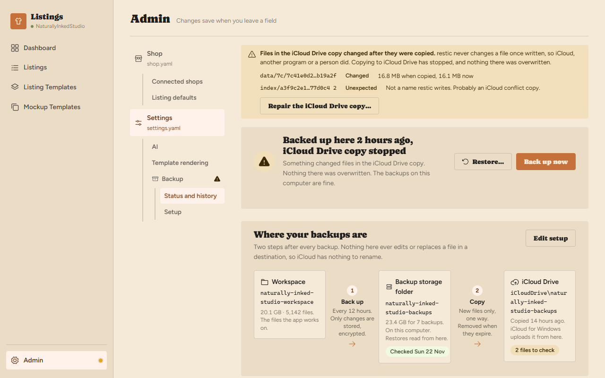

The banner lists each file the copy found, with a pill saying **Changed**
(expected and found sizes) or **Unexpected** (a name restic would not write).
The status headline says the copy to that destination stopped. The diagram's
destination pill counts the files. The history row for the run reads "Not
copied" with the reason.

**Repair the iCloud Drive copy…** opens a confirmation. It shows the folder the
files will be set aside in, and what will be copied again. **Set aside and copy
again** runs the repair with a spinner and the buttons disabled. When it ends,
the dialog closes, the warnings clear, and a note in the status panel names
the set-aside folder. The note has × to dismiss it. Cancel changes nothing.

## Restore

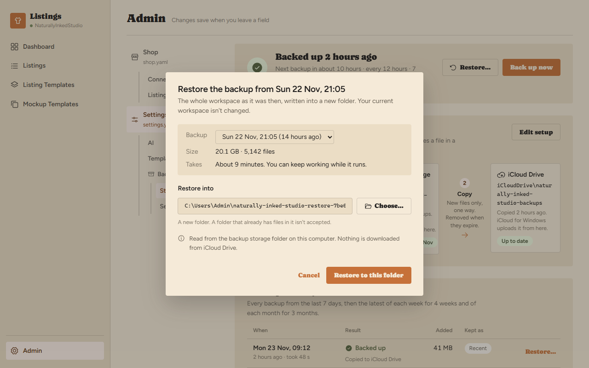

The restore dialog opens on the backup it was started from: the newest for the
status panel's Restore…, or that row's for a row's Restore…. The Backup select
can switch to any backup with a snapshot. The dialog shows the size, a time
estimate, and the target folder, named after the snapshot by default.

Typing the live workspace path into the target shows "That's your live
workspace. Choose a new, empty folder." and disables Restore. The server also
refuses a non-empty folder (spec, *Restore*); that message appears under the
field in the same place.

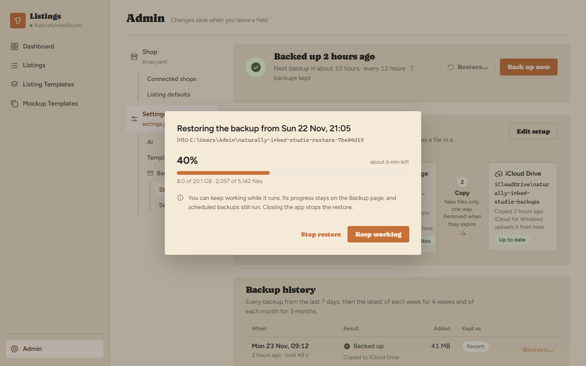

**Restoring.** The dialog becomes a progress view:
- a large percentage and the time left,
- the bar,
- GB and files restored out of the total,
- a note that the seller can keep working.

Its buttons are **Stop restore** and **Keep working**. While a restore runs,
every Restore… button is disabled, because only one runs at a time.

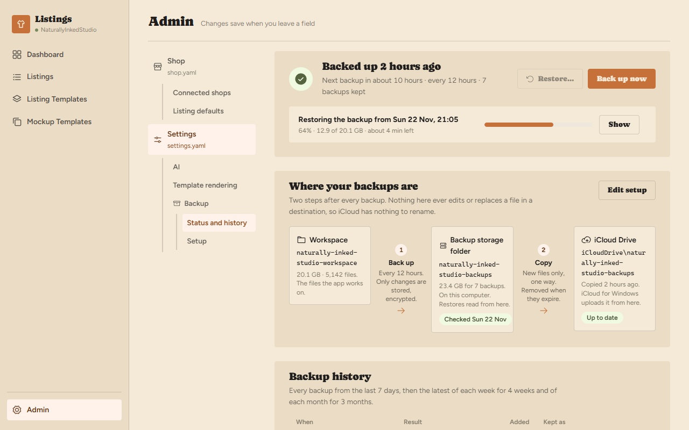

**Keep working** closes the dialog. A strip in the status panel shows the same
progress, and **Show** reopens the dialog. When the restore finishes:
- with the dialog open, the Restored dialog appears;
- with it closed, the strip becomes a note, and its **Show** opens the
  Restored dialog.

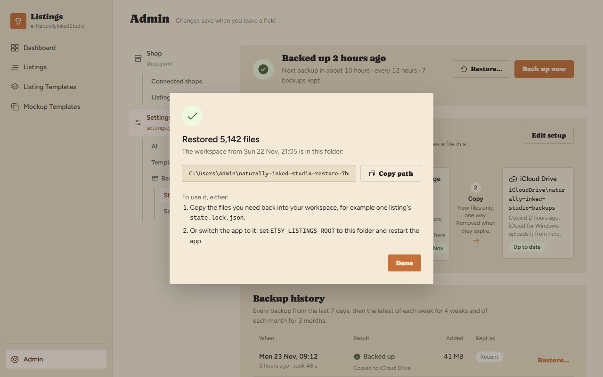

**Restored** names the folder, with Copy path, and the two ways to use it: copy
files back, or point `ETSY_LISTINGS_ROOT` at it and restart. **Stop restore**
leaves a note saying how far it got and that the partly restored folder must
be deleted before restoring there again.

## What the production implementation must finish

- **One status source.** A backup status endpoint feeds the shell (banner, dot),
  the nav icon and all three panels, so they agree. The shell polls it every
  2 seconds while a backup, repair or restore runs, so the running line moves,
  and every 30 seconds otherwise, so a warning appears or clears within half a
  minute. While a backup or a repair runs, Back up now and Try again wait for it;
  while a restore runs, every Restore… does.
- **A URL for Backup.** Admin sections are page state, not routes, so Open
  Backup has nothing to link to. Give Admin a section in the URL, such as
  `/admin?section=backup`, and keep the existing sections working.
- **Running and restore progress from the server.** The running line and the
  restore figures come from the backup job's status, which follows restic's
  `--json` progress. The prototype's `RUN_STEPS` and the timers in
  `_prototype.tsx` only imitate this.
- **Jobs waiting for a backup.** Deploy runs, AI runs, batch rows and Prepare
  jobs submitted during a pause show "Waiting for backup" where they show their
  state today (spec, *Pausing jobs*). The prototype does not show those pages.
- **Saving Setup.** Setup saves through the Admin settings revision check, like
  the AI section. A save that loses to another edit uses the existing reload
  flow.
- **Errors not prototyped:** a failed save, a folder that cannot be created, a
  wrong password when connecting an existing repository, the missing-repository
  state, a restore that fails part way, and a repair that fails.
- **Dark theme.** The app's stylesheet has no dark theme, so compare in light
  only.
